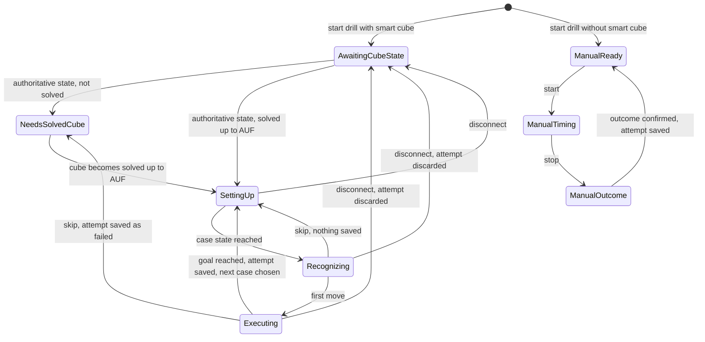
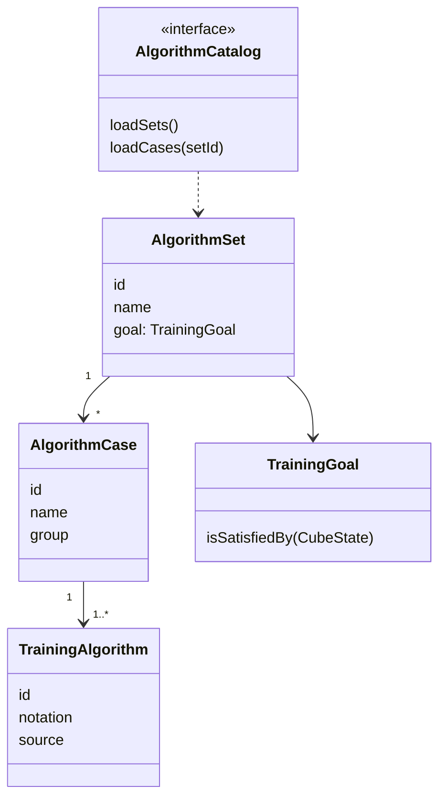
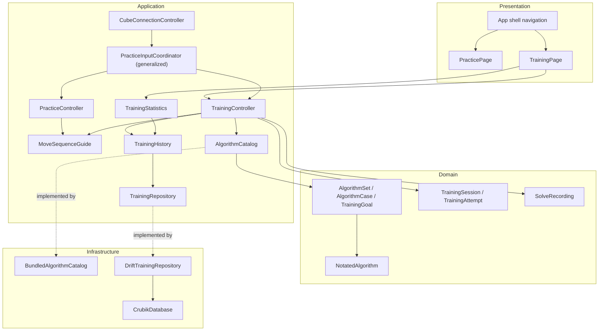
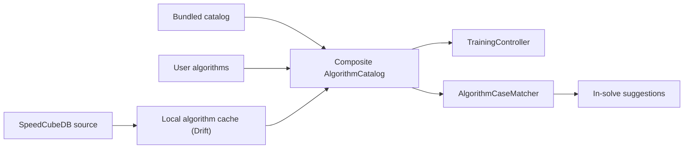

# Algorithm training mode design

Status: **proposal** for [issue #11](https://github.com/Hyponauts/Crubik/issues/11). Nothing described here is implemented yet. Once implementation starts, the current code structure belongs in [the architecture overview](architecture.md), and this document remains the record of intent, scope, and staging.

Related documents: [product vision](crubik-product-vision.md), [architecture overview](architecture.md), [glossary](glossary.md). Later stages prepare for [issue #9](https://github.com/Hyponauts/Crubik/issues/9) (SpeedCubeDB integration) and [issue #23](https://github.com/Hyponauts/Crubik/issues/23) (individual training plan).

## Summary

Algorithm training mode lets a cuber drill specific last-layer cases, such as individual PLL or OLL algorithms, in a dedicated workspace. Attempts are grouped into named training sessions and measured by recognition time, execution time, and error rate. Training data lives in its own tables with its own statistics view, so repetition drills never change best time, mean, or Ao5 of full solves.

The first implementation (MVP) is deliberately narrow: one bundled algorithm set (PLL), a zero-touch smart-cube drill loop, a hardware-free timing route, named sessions, and a per-case statistics view. The staging plan then extends it to the full feature, to remotely sourced algorithms, and to generated training plans without reshaping the MVP data model.

## Goals and non-goals

Goals:

- Drill one case, a hand-picked subset, or a whole algorithm set with minimal interaction between repetitions.
- Measure recognition time, execution time, and error rate per attempt, per case, and per session.
- Keep training attempts and statistics fully separate from full-solve history.
- Preserve the offline-first, no-account, local-source-of-truth principles: the bundled catalog and all training features work without a network.
- Keep raw attempt evidence so that derived metrics can be recomputed when classification rules improve.
- Leave clear variation points for additional algorithm sources (#9) and plan-driven drills (#23).

Non-goals for this feature as a whole:

- Changing the full-solve practice flow, its statistics, or the `crubik-solve-history` export format.
- Teaching a solving method from scratch, finger-trick video content, or social features.
- Puzzles other than 3×3.
- Per-stage analysis of full solves (cross, F2L, OLL, PLL splits). It shares the case matcher introduced later, but is a separate feature.

This feature is an "adjacent practice capability" in the product vision's evolution strategy. It does not change the scope of [the MVP target](crubik-mvp.md) for the first releasable product; "MVP" in this document always means the first increment of training mode.

## Terms

| Term | Meaning |
| --- | --- |
| Algorithm set | A named group of cases that share one goal, such as PLL or OLL. |
| Case | One recognizable cube situation within a set, such as the T permutation. A case is identified by a stable ID and by its cube state, not by any particular algorithm text. |
| Algorithm | One move sequence that solves a case. A case can have several algorithms from different sources. |
| Goal | The condition that ends an attempt successfully. For PLL it is "solved, ignoring the final U-layer turn". |
| AUF | Adjust U face: a U-layer turn before or after an algorithm. Random AUF makes a case appear from a random angle. |
| Setup | Moves that bring the cube from its current state to the case state. |
| Attempt | One timed repetition of one case. |
| Training session | A named, resumable bucket of attempts over a chosen selection of cases. |
| Drill | The definition of what to practice: cases, selection policy, hint policy, and stop condition. In the MVP every session runs one implicit open-ended drill. |
| Recognition time | Time from the case becoming ready to the first move of the attempt. |
| Execution time | Time from the first move of the attempt to reaching the goal. |

## User workflow

### Entry point and navigation

Navigation gains a third destination between the existing two: **Practice**, **Training**, **Session**. The existing **Session** destination keeps showing full-solve history only. Training has its own home, drill, and statistics views.

Switching between Practice and Training while an attempt or solve is in progress aborts that attempt after confirmation, the same way changing input mode does today. The connected cube stays connected across the switch.

### Training home

The home view lists existing training sessions with name, case selection summary, attempt count, and last-practiced date, plus a **New session** action. Selecting a session opens its statistics with a **Start** (or **Resume**) action.

Creating a session:

1. Pick an algorithm set (MVP: PLL only, so this step is preselected).
2. Pick cases: the whole set, a named group within it (for example "G permutations"), or individual cases from a grid of case diagrams.
3. Name the session. A default name is generated from the selection, such as "PLL – all" or "PLL – T perm".

### Drill loop with a smart cube

The loop needs no screen interaction between repetitions.

1. **Bring the cube to a known state.** If the cube is not solved (ignoring AUF), training asks the user to solve it first, mirroring the existing "needs solved cube" step.
2. **Setup.** Training picks the next case and shows setup moves using the same move-by-move guidance and wrong-move correction as scramble guidance. The 3D view mirrors the physical cube as always.
3. **Recognize.** The moment the cube reaches the case state, the case is ready and the attempt clock starts. The algorithm is hidden unless the user enabled **Show algorithm**.
4. **Execute.** The first move ends recognition and starts execution. The attempt completes automatically when the cube state satisfies the goal.
5. **Result.** Recognition, execution, and total time appear briefly together with the outcome, and setup guidance for the next case starts immediately from the cube's current state.

At any time the user can **Skip** the current case (recorded as a failed attempt once execution has started, otherwise not recorded), **Pause**, or **Finish** the drill and return to session statistics.



### Drill loop without a smart cube

The hardware-free route stays first-class but measures less, and says so.

1. The view shows the case diagram on the virtual cube and the setup moves as text, for the user to apply to an ordinary cube.
2. Spacebar or a tap starts the attempt timer; spacebar or a tap stops it. This reuses the existing touch and keyboard timing behavior.
3. The user confirms the outcome: **Good** (default, Enter or Space) or **Mistake**.

Only total time is recorded. Recognition and execution times are stored as unavailable rather than estimated, and statistics label manual attempts accordingly.

### Statistics

Training statistics are reachable only from the Training destination. For a session they show:

- totals: attempts, error rate, time practiced;
- per-case rows: attempt count, error rate, and best / mean / Ao5 for recognition, execution, and total time, sortable so the weakest cases surface first;
- the recent attempts list with per-attempt deletion.

A set-level overview aggregates the same per-case rows across all sessions, which answers "how good am I at the T perm overall" independent of which session produced the attempts.

Statistics distinguish states with text and icons, not color alone, and mark timing as unavailable instead of showing zero.

## Metric definitions

All timing uses the app-owned monotonic clock and host receipt timestamps, exactly like full solves.

| Metric | Smart cube | Without smart cube |
| --- | --- | --- |
| Case ready | Host timestamp of the event that brings the cube to the case state. | Not observed. |
| Recognition time | First attempt move − case ready. | Unavailable. |
| Execution time | Goal-reaching event − first attempt move. | Unavailable. |
| Total time | Goal-reaching event − case ready. | Timer stop − timer start. |
| Outcome | Derived from recorded moves, see below. | Self-reported. |

Attempt outcome:

- `clean`: the goal was reached and the move stream contains no immediate reversal, meaning no quarter turn directly undone by the opposite quarter turn of the same face.
- `corrected`: the goal was reached, but the move stream contains at least one immediate reversal.
- `failed`: the user skipped after starting execution, or self-reported a mistake in the manual route.

**Error rate** is `(corrected + failed) / attempts`. Time statistics use `clean` and `corrected` attempts with reliable timing; `failed` attempts count only toward error rate.

The reversal rule is intentionally simple, independent of which algorithm the user prefers, and explainable. It misses a wrong turn that is fixed by a longer detour; the full feature adds comparison against the user's chosen algorithm. Because the raw recording is kept, older attempts can be reclassified.

Timing reliability follows the rules already used for solves: if the first or the goal-reaching move was recovered rather than observed live, or a state report establishes an unobserved boundary, the attempt is saved with timing unavailable and excluded from time statistics.

Known limitation: with a smart cube the user performs the setup moves, so recognition is not fully "cold", and recognition time includes the regrip after setup. Random AUF and solver-generated setups (full feature) reduce the first effect. The metric is still consistent from attempt to attempt, which is what progress tracking needs.

## Domain design

### Algorithm notation

`CubeMove` models only the six face turns, which is what smart cubes report and what protocol code depends on. Common last-layer algorithms also use wide turns (`r`, `Rw`), slice turns (`M`, `E`, `S`), and whole-cube rotations (`x`, `y`, `z`).

Training adds a notation model in the pure cube domain (working name `NotatedAlgorithm`) that:

- parses standard notation including wide, slice, rotation tokens and grouping parentheses, preserving the original text for display;
- lowers itself to a plain face-turn sequence in the fixed-center frame, plus the accumulated whole-cube rotation.

Lowering matches how hardware behaves: a smart cube has no notion of center orientation, so `M` arrives as `R` and `L'` in either order and `r` arrives as `L`. `CubeMove`, `CubeState`, and protocol decoders stay unchanged.

Because attempt completion is decided by cube state, not by matching the move stream against the algorithm, the MVP is insensitive to the order in which a slice turn's two face events arrive.

### Catalog model



- Case IDs are stable, namespaced strings such as `3x3/pll/t`. Attempts reference the case ID, so statistics survive algorithm text changes and new algorithm sources.
- A case's canonical state is computed by applying the inverse of its lowered reference algorithm to the solved cube. Two algorithms belong to the same case when they produce the same state up to AUF. This state-based identity is what later lets remotely sourced algorithms attach to existing cases.
- `TrainingGoal` is a predicate over `CubeState`. PLL uses "solved after some U turn". OLL later uses "first two layers solved and all U-face stickers oriented". A sticker mask plus an AUF allowance covers the common sets.
- `AlgorithmCatalog` is an application-owned, asynchronous interface. The MVP implementation returns bundled constant data. The interface is asynchronous from the start so cached remote sources fit without changing consumers.

The bundled PLL data must be authored for Crubik or taken from a source whose license permits redistribution, with `THIRD_PARTY_NOTICES.md` updated in the same change when it applies. A catalog test verifies that every bundled algorithm parses and solves its own case to the set's goal.

### Sessions, attempts, and selection

```dart
final class TrainingSession {
  final String id;
  final String name;
  final String algorithmSetId;
  final List<String> caseIds;
  final DateTime createdAt;
}

final class TrainingAttempt {
  final String id;
  final String sessionId;
  final String caseId;
  final String? algorithmId;
  final DateTime createdAt;
  final SolveInputSource inputSource;
  final TrainingAttemptOutcome outcome;
  final Duration? recognitionElapsed;
  final Duration? executionElapsed;
  final Duration totalElapsed;
  final bool isTimingReliable;
  final int moveCount;
  final String setup;
  final bool wasAlgorithmShown;
}
```

`algorithmId` records which algorithm was the case's selected one at attempt time. It is always the bundled one in the MVP, and becomes meaningful when a case has several algorithms.

`wasAlgorithmShown` separates learning repetitions from recall repetitions, so later statistics and training plans can treat them differently.

Next-case selection sits behind a small `CaseSelectionPolicy` contract. The MVP policy is a shuffle bag: every selected case appears once per cycle in random order, with no immediate repeat across cycle boundaries. A single-case session simply repeats it with a fresh random AUF.

### Setup generation

In the MVP the setup for a case is the inverse of its lowered reference algorithm with a random AUF before and after, prefixed by whatever U turn is needed from the cube's current state. PLL attempts always end solved up to AUF, so this needs no solver and has no waiting time.

## Application and infrastructure design

### Components

Training is a new feature folder, `lib/features/training`, with `domain`, `application`, and `presentation` layers that mirror the practice feature. Persistence adapters join the shared database code under `lib/core/data`.

| Component | Responsibility |
| --- | --- |
| `TrainingController` | Sole owner of training phases and the attempt clock. Chooses the next case, tracks setup, detects case-ready and goal-reached, builds attempts, and hands them to `TrainingHistory`. A `ChangeNotifier`, like `PracticeController`. |
| `TrainingHistory` | Loads sessions and attempts, serializes writes with retry, and exposes them to statistics. Follows the `SolveHistory` write-ordering rules. |
| `TrainingStatistics` | Pure calculation of per-case, per-session, and per-set figures from attempts. |
| `AlgorithmCatalog` / `BundledAlgorithmCatalog` | Catalog interface and its bundled implementation. |
| `TrainingRepository` / `DriftTrainingRepository` | Feature-owned storage contract and its Drift implementation. |
| `TrainingPage` and layouts | Home, session setup, drill, and statistics views with separate compact and wide compositions. |



### Changes to existing code

Three existing areas change. Each is a behavior-preserving refactoring that can land before any training UI.

1. **Smart-cube event routing.** `PracticeInputCoordinator` currently forwards every cube event to `PracticeController`. It gains the notion of an active workspace and forwards events to exactly one consumer through a narrow application-owned interface (activate smart-cube input, handle event, mark disconnected) that both controllers implement. On a workspace switch the outgoing controller aborts its attempt and the incoming one receives the latest authoritative state event. The rule that UI code never reads state from the coordinator stays.
2. **Move-sequence guidance.** Scramble progress, correction detection, and recovery-move calculation are private to `PracticeController`. They move into a pure `MoveSequenceGuide` that both controllers use: scramble guidance for practice, setup guidance for training. Existing controller tests keep guarding the behavior.
3. **Top-level navigation.** `PracticePage` currently owns the navigation rail and bottom bar. Navigation chrome moves to a small app shell so Practice, Training, and Session are siblings. Keyboard timing stays enabled only on the destination that is active and never while a dialog or editable control has focus.

`SolveRecordingBuilder` is reused as is: it is already independent of practice phases, timers, and storage. `TrainingController` starts a recording when the case becomes ready, so the first move's offset is the recognition time, and finishes it at the goal.

`CrubikApp` creates and owns `TrainingController` alongside the existing controllers and flushes training writes before closing the database.

### Persistence

Schema version 5 adds three tables and changes none of the existing ones.

| Table | Content |
| --- | --- |
| `training_sessions` | `id`, `name`, `algorithm_set_id`, `case_ids` (JSON array), `created_at`. |
| `training_attempts` | `id`, `session_id` (cascade delete), `case_id`, `algorithm_id` (nullable), `created_at`, `input_source`, `outcome`, `recognition_ms` (nullable), `execution_ms` (nullable), `total_ms`, `timing_reliable`, `move_count`, `setup`, `algorithm_shown`. |
| `training_attempt_recordings` | `attempt_id` (cascade delete), `payload`: the same gzip-compressed `SolveRecording` JSON produced by the existing codec. |

Rules carried over from solve persistence:

- An attempt summary and its recording are saved in one transaction.
- Startup loads sessions only. Attempts load when a session or set overview is opened; recordings load only for export or reclassification.
- Writes are serialized in completion order and retried after failure.
- Outcome and input source are stored as strings, and unknown values are preserved on read.
- The migration from version 4 only creates tables and needs a migration test.

Recordings contain the same privacy-safe content as solve recordings: no device identity, packets, signal strength, or battery values.

### Export

Training data gets its own versioned document, `crubik-training-history` version 1, exported from the training statistics view. It contains sessions, attempts, the catalog case ID and algorithm text for each attempt, and nested recordings where they exist. The `crubik-solve-history` format is not changed.

## MVP scope

Included:

- Notation model with wide, slice, and rotation moves, lowered to face turns.
- Bundled PLL set: 21 cases with one algorithm each, grouped for selection.
- Training destination with home, session creation (whole set, group, or individual cases), drill, and statistics views in compact and wide layouts.
- Smart-cube drill loop: solved check, guided setup with random AUF, automatic case-ready, first-move and goal detection, automatic advance, skip.
- Hardware-free drill loop: case diagram, setup text, spacebar and touch timing, self-reported outcome.
- **Show algorithm** toggle, recorded per attempt.
- Recognition, execution, and total time; `clean` / `corrected` / `failed` outcome; error rate.
- Per-session and per-set statistics with per-case rows; attempt and session deletion.
- Schema version 5, attempt recordings, and `crubik-training-history` export.
- The three refactorings listed under "Changes to existing code".

Deferred:

- OLL and other sets, custom algorithms, choosing among several algorithms per case.
- Solver-generated setups and recovery guidance after a failed attempt (the MVP asks the user to solve the cube).
- Weakness-weighted case selection, attempt timeouts, drill stop conditions.
- Deviation detection against the selected algorithm, trend charts, replay.
- Any network use.

### Suggested delivery order

Each step is independently reviewable and keeps `flutter analyze` and `flutter test` green.

1. Notation model and lowering, with domain tests.
2. `MoveSequenceGuide` extraction from `PracticeController`.
3. Coordinator event routing and app-shell navigation with an empty Training destination.
4. Catalog model, `TrainingGoal`, and bundled PLL data with the self-verifying catalog test.
5. Training domain records, repository contract, Drift tables, migration, and `TrainingHistory`.
6. `TrainingController` state machine for both input routes.
7. Drill views, then session creation and home views.
8. `TrainingStatistics`, statistics views, and export.
9. Documentation: architecture overview, glossary, README feature list.

### Verification

Regression tests required by the contributor guide, by layer:

- **Cube domain:** notation parsing and round trips; lowering of wide, slice, and rotation moves verified against cube states; case-state equivalence up to AUF; goal predicates.
- **Catalog:** every bundled algorithm parses, solves its case, and no two cases share a state.
- **Controller:** full smart-cube loop with a fake clock; wrong setup moves and correction; slice turns arriving in either face order; recovered boundary moves marking timing unavailable; disconnect during each phase; skip in each phase; manual route timing and outcome.
- **Coordinator:** events reach only the active workspace; a workspace switch aborts the attempt in progress and syncs the latest state.
- **Persistence:** version 4 to 5 migration; transactional attempt and recording writes; cascade deletion; write ordering and retry.
- **Statistics:** error rate, exclusion of unreliable and failed attempts from time figures, Ao5 availability.
- **Presentation:** compact phone and wide desktop layouts without overflow; long session and case names; dialogs and the session-name field not triggering the timing shortcut; semantic labels for outcomes and case diagrams.

Physical-cube checks before release: fast execution at high turn speed, algorithms with `M` and wide moves, missed-move recovery in the middle of an attempt, and disconnect/reconnect during a drill, on the device combinations listed in [cube device compatibility](cube-device-compatibility.md).

## Development plan beyond the MVP

### Stage 2: complete issue #11

- **More sets.** OLL first, then sets such as F2L or COLL, each defined by a `TrainingGoal` mask. Attempts on these sets do not end in a solved cube, which brings in the next two items.
- **Solver-backed setups.** Generate setups from the cube's current state to the next case state through the `CubeSolver` abstraction, so drills continue without re-solving and setups no longer mirror the algorithm. This needs state composition on `CubeState` and a small cache of prepared setups, following the `ScrambleCache` pattern. Random states for the unconstrained pieces (for example a random permutation behind an OLL case) make recognition realistic.
- **Recovery guidance.** After a failed attempt, guide the cube straight to the next case instead of asking for a manual solve.
- **User algorithms.** Add, edit, and select the preferred algorithm per case. Input is validated by parsing and by checking that it solves the case to the goal.
- **Reference comparison.** Classify deviations from the selected algorithm, tolerant of AUF and of slice-turn event order, and show where in the algorithm mistakes cluster. Old attempts are reclassified from recordings.
- **Adaptive selection.** A `CaseSelectionPolicy` weighted toward slow or error-prone cases, and drill stop conditions by attempt count or duration.
- **Richer statistics.** Trends over time, per-algorithm comparison for the same case, Ao12, recognition-versus-execution breakdown, and attempt replay from recordings.
- **Portability.** Import of `crubik-training-history`, and user algorithms included in export.

### Stage 3: SpeedCubeDB integration (issue #9)

The MVP's catalog boundary is the integration point. Remote data becomes one more source behind `AlgorithmCatalog`; the training loop, attempts, and statistics do not change.



- **Before any code:** confirm that SpeedCubeDB offers a programmatic interface and that its terms allow fetching, caching, and displaying its data in Crubik. This design does not assume either. If not, the same slot can hold a user-initiated import instead.
- **Fetch and cache.** A remote source fetches algorithm data on explicit user action or opt-in refresh and stores it in local tables with source, fetch time, and attribution. Training and suggestions read only the local cache, so they keep working offline. Requests carry no user data.
- **Attach by state, not by name.** Each fetched algorithm is parsed, lowered, and applied to derive its case state, then attached to the existing case with the same state up to AUF. Algorithms that fail to parse or do not solve their case are rejected. This is why case identity is state-based from the MVP on.
- **Ranking and one-tap apply.** Algorithms for a case are ranked by source data such as popularity, and later by the user's own measured times per `algorithm_id`. Applying a suggestion selects it as the user's algorithm for that case and can add the case to a training session.
- **In-solve suggestions.** Issue #9's "match current cube state" needs an `AlgorithmCaseMatcher` that maps a live `CubeState` to a set, case, and AUF using the same goals and case states. It serves suggestions after or during full solves and is independent of the training loop.

### Stage 4: individual training plan (issue #23)

A training plan is a scheduler above training mode. It decides what to drill; training mode already knows how to run and measure a drill.

- **Drill as the unit of work.** The implicit MVP drill becomes an explicit `TrainingDrill` value: case IDs, selection policy, hint policy (learn with the algorithm shown, or recall), and stop condition. A plan produces a list of drills per day and starts them through the same `TrainingController`.
- **Mastery signals.** Plans read per-case figures derived from attempts: error rate, recognition and execution time against a target, attempt count, and time since last practice. `wasAlgorithmShown` separates learning from recall. Everything is derived from stored attempts, so plan logic can change without data migration.
- **Assessment.** The onboarding assessment is an ordinary drill over a set whose results seed the mastery figures, combined with full-solve statistics for overall level.
- **Progression.** Introduce new cases in small groups, schedule reviews with growing intervals for mastered cases, and mix in full solves. Plan state and daily completion are stored locally in their own tables.
- **Traceability.** Attempts gain an optional reference to the plan item that requested them, added as a nullable column, so adherence and plan adjustments can be explained from data.

Plans stay local and optional. Practicing freely without a plan remains the default path.

## Documentation impact

When the MVP is implemented, the same changes update:

- [architecture overview](architecture.md): feature area, responsibilities table, dependency diagram, coordinator routing, schema version 5, and the extension guidance for adding an algorithm set;
- [glossary](glossary.md): algorithm set, case, AUF, recognition and execution time;
- `README.md` feature list, and `THIRD_PARTY_NOTICES.md` if bundled algorithm data comes from a third-party source.

The product vision needs no change: the feature follows its evolution strategy and principles.

## Open questions

1. **Session semantics.** This design treats a session as a long-lived named bucket, like the issue's "named training sessions per algorithm or algorithm set". Should a session instead be a single sitting, with the named selection modeled separately?
2. **Recognition start.** Is "case state reached" acceptable as the recognition start for smart cubes, or should there be an explicit arm step (for example a short hands-off pause) before the clock starts?
3. **Failure by timeout.** Should an attempt fail automatically after a configurable time, or only on skip?
4. **Export shape.** Separate `crubik-training-history` document (proposed), or a training section in a new `crubik-solve-history` version?
5. **Algorithm data.** Who authors the bundled PLL list, and which default algorithms does it use?
6. **SpeedCubeDB access.** Availability and terms of a programmatic interface are unverified and decide the shape of stage 3.

## Decisions

- **MVP set: PLL only** (decided 2026-11-15). Every MVP attempt ends in a solved cube up to AUF, so setups need no solver. OLL and solver-backed setups stay in stage 2.
