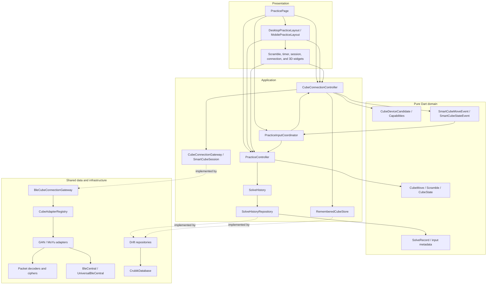
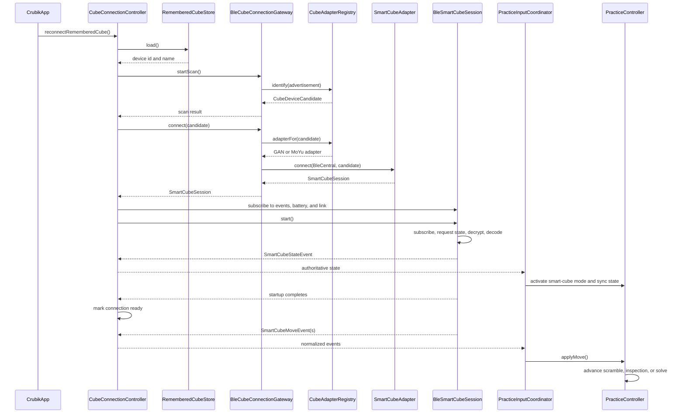
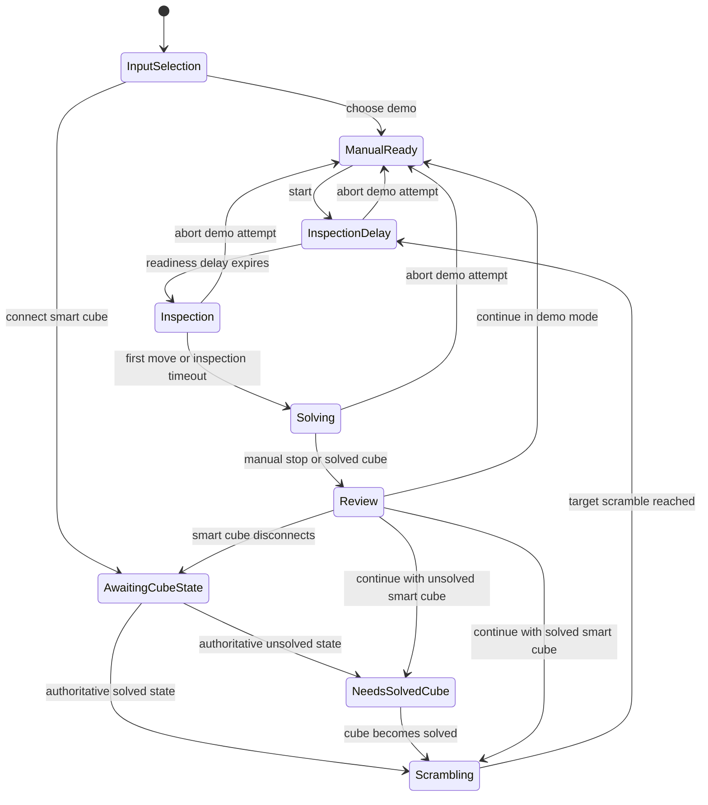
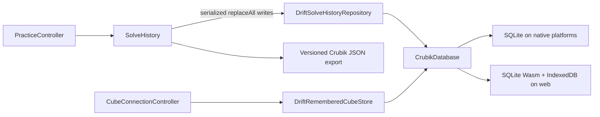

# Crubik architecture overview

This document describes the current structure and runtime behavior of Crubik.

Use this document for current component ownership, dependency boundaries, and runtime flows. Use [the product vision](crubik-product-vision.md) for enduring product direction and [Crubik cube device compatibility](cube-device-compatibility.md) for protocol coverage, validation evidence, and release support status. When the implementation changes any architecture shown here, update the relevant text, responsibility table, and Mermaid diagrams in the same change.

## Architectural goals

Crubik is an offline-first Flutter application. The complete practice loop, including input, scramble guidance, timing, visualization, history, statistics, and export, must remain available without an account, backend, or network connection.

The architecture supports that product requirement through these rules:

- Dependencies point toward application-owned contracts and pure domain models. Widgets do not decode Bluetooth packets or own solve rules.
- `PracticeController` is the single owner of the practice state machine and timer.
- `CubeConnectionController` owns physical discovery and connection lifecycle; vendor-specific behavior remains behind gateway and adapter contracts.
- `PracticeInputCoordinator` stays narrow: it handles actions and normalized events that span the practice and connection controllers. Presentation reads each controller directly.
- Local persistence is authoritative. Shared Drift infrastructure implements feature-owned contracts without leaking database types into feature logic.
- Smart-cube adapters publish vendor-neutral `SmartCubeMoveEvent` and `SmartCubeStateEvent` objects. Pairing or packet tests alone do not establish real-hardware compatibility.

## Code organization and dependency view

The code is split into presentation, application, domain, transport/protocol, and persistence boundaries.

The main source areas are:

| Area | Location | Purpose |
| --- | --- | --- |
| Composition | [`lib/app`](../lib/app) | Constructs and owns production controllers, coordinators, and shared resources. |
| Shared infrastructure | [`lib/core`](../lib/core) | Cross-feature data infrastructure and application theme. |
| Cube domain | [`lib/features/cube/domain`](../lib/features/cube/domain) | Pure cube, device, capability, event, and diagnostic models. |
| Cube application | [`lib/features/cube/application`](../lib/features/cube/application) | Connection lifecycle and application-owned transport/store contracts. |
| Cube data | [`lib/features/cube/data`](../lib/features/cube/data) | BLE boundary, adapter registry, vendor sessions, ciphers, and packet decoders. |
| Practice domain | [`lib/features/practice/domain`](../lib/features/practice/domain) | Durable solve records and persistence contract. |
| Practice application | [`lib/features/practice/application`](../lib/features/practice/application) | Practice state machine, input coordination, history, and statistics. |
| Practice presentation | [`lib/features/practice/presentation`](../lib/features/practice/presentation) | Responsive layouts, controls, history views, and cube rendering. |

## Main responsibilities

| Class or contract | Responsibility |
| --- | --- |
| `CrubikApp` | Composition root. It owns the production controllers, shared database, and input coordinator; starts history loading and remembered-cube reconnect; and flushes persistence before closing its database. |
| `PracticePage` | Top-level navigation and responsive breakpoint selection. It observes practice and connection controllers directly, invokes the coordinator for cross-controller input actions, and limits keyboard timing to the active practice destination. |
| `DesktopPracticeLayout` / `MobilePracticeLayout` | Distinct wide and compact compositions for preparation, active attempts, solve review, and session history. |
| `PracticeInputCoordinator` | Coordinates operations spanning practice and physical connection: demo selection, connect transitions, disconnect handling, and normalized event forwarding. It does not expose presentation state. |
| `PracticeController` | Owns scramble state, authoritative cube state, inspection and timer transitions, move capture, solve completion, review data, and next-scramble preparation. |
| `SolveHistory` | Computes best, mean, and Ao5; merges mutations made during initialization; serializes persistence writes; and produces versioned export JSON. |
| `SolveRecord` | Durable solve summary containing timing, move count, input source, inspection duration, and solve-start trigger. |
| `CubeConnectionController` | Owns discovery, permissions, scan cancellation, startup reconnect, session lifecycle, battery state, redacted diagnostics, and normalized event publication. |
| `CubeConnectionGateway` | Application-owned discovery and connection boundary. BLE is its production implementation, but application code does not depend on the BLE plugin. |
| `SmartCubeSession` | Vendor-neutral session contract for authoritative startup, state requests, normalized events, battery, link state, and cleanup. |
| `BleCubeConnectionGateway` | Maps BLE advertisements through the adapter registry and delegates connection to the selected adapter. |
| `BleCentral` / `UniversalBleCentral` | Testable BLE boundary and its `universal_ble` implementation. |
| `CubeAdapterRegistry` | Ordered device recognition, support classification, protocol display names, and adapter selection. |
| `SmartCubeAdapter` | Per-protocol recognition and session-construction contract. |
| `BleSmartCubeSession` | Shared subscription, startup, and cleanup behavior for encrypted BLE cube sessions. |
| `InitialStateHandshake` | Requires observable authoritative-state evidence before a connection becomes ready and records redacted failure diagnostics. |
| GAN adapters and protocol classes | Handle GAN Gen2–4 and MoYu AI 2023 service selection, MAC-salted AES, state and move decoding, and missed-move recovery. |
| MoYu32 adapters and protocol classes | Handle MoYu32 identity resolution, cipher, state, move, and battery parsing, five-move recovery, timestamps, and resynchronization. |
| `CubeMove`, `Scramble`, and `CubeState` | Pure 3×3 notation and transformation model shared by protocols, practice logic, and visualization. |
| `ScrambleGenerator` | Generates local 20-move practice scrambles while avoiding repeated faces and three consecutive moves on one axis. Its output is not a WCA random-state scramble. |
| `CrubikDatabase` | Shared Drift schema and migrations for solve entries and application settings. |
| `DriftSolveHistoryRepository` | Maps durable solve rows to forward-compatible domain records. |
| `DriftRememberedCubeStore` | Persists the most recently connected device identifier and display name. |
| `Cube3DView` | Flutter-native projection, interaction, move animation, reduced-motion behavior, and custom painting. |

## Smart-cube connection and event flow

`CubeConnectionController` subscribes to session events, battery updates, and link state before calling `SmartCubeSession.start()`. Startup is not complete until the adapter has subscribed to notifications and `InitialStateHandshake` has observed an authoritative cube state. This ordering prevents the initial state from being lost between subscription and startup.

The same event path handles live moves, state resynchronization, and solved-state completion. `PracticeController` records whether completion came from locally applied moves or from an authoritative state packet. Vendor packets, decrypted payloads, and device identifiers must not escape into widgets or unredacted production diagnostics.

The production registry currently selects packet-tested adapters for GAN Gen2–4, MoYu AI 2023, and MoYu32. Protocol coverage, hardware-validated combinations, and release support are separate evidence levels; see the cube device compatibility document for the evidence matrix and physical-device compatibility validation criteria.

## Practice lifecycle

`PracticeController` is the single owner of the timer and practice state machine. Manual/demo input begins ready with the rendered cube initialized to the scramble target. Smart-cube input begins by waiting for authoritative physical state and never overwrites that state merely because a new scramble was generated.

The diagram is a user-flow view. `InputSelection` and `Review` are conceptual states rather than `PracticePhase` enum values. Review is represented by `pendingSolveReview`; after completion, the next scramble and underlying practice phase are already prepared.

For smart-cube attempts, aborting or dismissing review returns to `AwaitingCubeState`, `Scrambling`, or `NeedsSolvedCube` according to whether an authoritative state is known and whether the physical cube is solved. A solve can finish from a solved state packet as well as from locally accumulated move events; both paths must remain supported.

## Persistence and offline behavior

The shared database and both concrete persistence adapters live under `lib/core/data` because the database serves practice history and remembered cube state. Feature code continues to depend on feature-owned repository and store contracts.

Persistence follows these invariants:

- Local state is authoritative; capture and review have no network dependency.
- `SolveHistory` serializes writes so consecutive solves cannot persist out of order.
- Initialization merges solves and deletions made while stored history is loading.
- `CrubikApp` flushes pending history operations before closing the database it owns.
- Native platforms use Drift over SQLite. Web uses the committed, version-matched `sqlite3.wasm` payload and the ignored `drift_worker.dart.js` payload generated by build_runner, backed by IndexedDB.
- Drift schema changes require locally regenerating ignored `*.g.dart` source with build_runner, migrations when `schemaVersion` increases, and migration tests. Build runner also compiles and materializes the ignored Drift web worker before Flutter web builds. Generated Dart source and JavaScript runtime output are never committed.
- The versioned Crubik JSON format must evolve compatibly and retain unknown input-source values. Raw move-event export is not yet lossless.

## Extension points

When adding a smart-cube protocol:

1. Keep recognition and session construction behind `SmartCubeAdapter`.
2. Register supported adapters before detection-only recognizers in `CubeAdapterRegistry`.
3. Translate packets into normalized smart-cube events before they reach the application layer.
4. Preserve timestamps, move and state serials, recovery ordering, and redacted diagnostics.
5. Add deterministic packet, encryption, startup, recovery, malformed-input, and connection-controller tests. Treat physical-device compatibility validation as a separate real-hardware step.

When changing the practice flow, place transitions and timing rules in `PracticeController`. Keep presentation responsible for layout and interaction only, and keep `PracticeInputCoordinator` limited to behavior that genuinely spans practice and physical connection.

When changing durable data, extend the feature-owned record and contract first, then update the Drift implementation and the versioned export format without discarding raw evidence or breaking older data.

## Keeping this document current

Architecture documentation is part of the implementation. A change must update this document when it alters any of the following:

- component ownership or a public application contract;
- dependency direction or feature boundaries;
- smart-cube discovery, connection, handshake, or normalized event flow;
- practice phases, timer ownership, input transitions, or completion paths;
- persistence ownership, schema flow, initialization, flushing, or export;
- current extension points or supported protocol families.

Update explanations, tables, and every affected diagram together. Remove obsolete names rather than documenting compatibility aliases that do not exist in the code.
