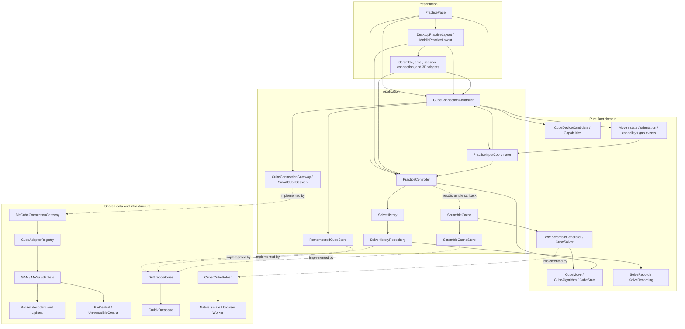
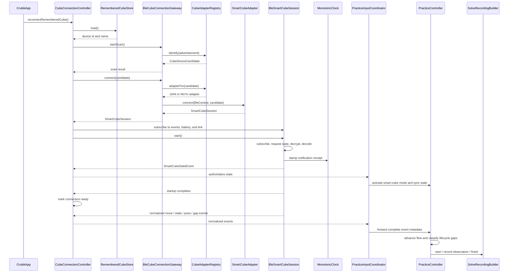
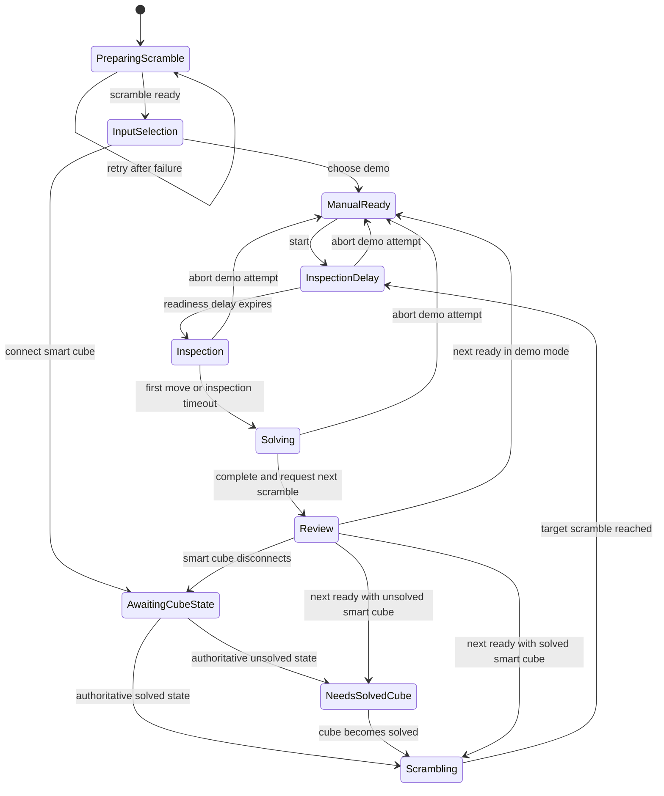
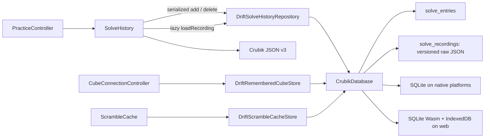

# Crubik architecture overview

This document describes how Crubik's code is organized and how the app works while running.

Use it to understand which component handles each task, which parts depend on each other, and how data moves through the app. See [the product vision](crubik-product-vision.md) for long-term direction and [cube device compatibility](cube-device-compatibility.md) for implemented protocols, test results, and release support. The [shared glossary](glossary.md) explains recurring technical terms. When code changes affect this architecture, update the relevant text, tables, and Mermaid diagrams in the same change.

## Architectural goals

Crubik is an offline-first Flutter app. The full practice loop—input, scramble guidance, timing, visualization, history, statistics, and export—must work without an account, server, or network connection.

The code follows these rules to keep practice available offline:

- Application logic depends on interfaces defined by the app and domain models that do not need Flutter, Bluetooth, or a database. Widgets do not decode Bluetooth packets or decide solve rules.
- `PracticeController` alone controls practice phases and the timer.
- `CubeConnectionController` manages finding and connecting to physical cubes. Gateways and adapters handle vendor-specific details through common interfaces.
- `PracticeInputCoordinator` handles only actions and common cube events that involve both the practice and connection controllers. UI code reads each controller directly.
- The local database is the source of truth for saved data. Shared Drift code implements each feature's storage interfaces; feature logic does not use database-specific types.
- Smart-cube adapters send common move, state, orientation, capability, and data-gap events. Pairing or passing packet tests alone does not prove that a real cube works with Crubik.

## Code organization and dependency view

The code is split into UI (presentation), workflow coordination (application), models and rules (domain), device communication (transport/protocol), and saved data (persistence).

The main source areas are:

| Area | Location | Purpose |
| --- | --- | --- |
| App setup | [`lib/app`](../lib/app) | Creates and owns the app's controllers, coordinators, and shared resources. |
| Shared infrastructure | [`lib/core`](../lib/core) | Storage code used by multiple features, a shared monotonic clock, and the app theme. |
| Cube domain | [`lib/features/cube/domain`](../lib/features/cube/domain) | Models for cubes, devices, features, events, and diagnostics, independent of Flutter and device APIs. |
| Cube application | [`lib/features/cube/application`](../lib/features/cube/application) | Connection management and app-defined interfaces for device communication and storage. |
| Cube data | [`lib/features/cube/data`](../lib/features/cube/data) | BLE access, adapter selection, vendor sessions, encryption, and packet decoding. |
| Practice domain | [`lib/features/practice/domain`](../lib/features/practice/domain) | Saved solve summaries, detailed recordings, timing calculations, and the storage interface. |
| Practice application | [`lib/features/practice/application`](../lib/features/practice/application) | Practice phases and transitions, input coordination, history, and statistics. |
| Practice presentation | [`lib/features/practice/presentation`](../lib/features/practice/presentation) | Responsive layouts, controls, history views, and cube rendering. |

## Main responsibilities

| Class or contract | Responsibility |
| --- | --- |
| `CrubikApp` | Creates and owns the controllers, shared database, monotonic clock, scramble cache and solver, and input coordinator. Starts history loading and reconnects to the remembered cube. Saves pending changes before closing its database. |
| `PracticePage` | Handles top-level navigation and chooses the layout for the screen width. Reads both controllers directly and uses the coordinator for actions involving both. Enables keyboard timing only on the active practice screen. |
| `DesktopPracticeLayout` / `MobilePracticeLayout` | Separate wide and compact layouts for preparation, attempts, solve review, and session history. |
| `PracticeInputCoordinator` | Coordinates demo selection, connection changes, disconnect handling, and forwarding common cube events. These operations involve both controllers. UI code does not read state from the coordinator. |
| `PracticeController` | Controls the scramble, current cube state, inspection, timer, when to start or stop recording, solve completion, review data, and preparation of the next scramble. |
| `ScrambleCache` / `ScrambleCacheStore` | Maintains a sequential FIFO pool of ready scrambles behind a feature-owned persistence contract. Taking an item removes it before returning and then starts background refill; ready items remain available while the next item is generated, and an empty pool never substitutes a move-list fallback. |
| `SolveRecordingBuilder` | Builds an ordered event timeline with times relative to solve start. Keeps relevant pre-start observations, selects orientation samples to retain, detects clock jumps, and finishes the recording. Does not depend on practice phases, timers, or storage. |
| `SolveHistory` | Calculates best, mean, and Ao5. Merges changes made while history loads. Runs writes and export in order, keeps failed writes for retry, loads detailed recordings only when needed for export, and produces versioned JSON. |
| `SolveRecord` | Saved solve summary: timing availability, move count, input source, inspection duration, and what started the solve. |
| `SolveRecording` | Versioned timeline in a common format across vendors. Contains observed moves, cube-reported states, selected orientation samples, data gaps, available host and cube times, and protocol features. Times between moves are calculated later, not stored. |
| `CubeConnectionController` | Manages discovery, permissions, scan cancellation, startup reconnect, sessions, battery state, diagnostics with private data removed, and common cube events. |
| `CubeConnectionGateway` | App-defined interface for finding and connecting to cubes. The app uses a BLE implementation, while application logic stays independent of the BLE plugin. |
| `SmartCubeSession` | Common interface for a cube connection: startup confirmed by a cube-state report, state requests, events, battery, connection status, and cleanup. |
| `BleCubeConnectionGateway` | Uses the adapter registry to identify BLE advertisements, then asks the selected adapter to connect. |
| `BleCentral` / `UniversalBleCentral` | BLE interface that can be replaced in tests, and its `universal_ble` implementation. |
| `CubeAdapterRegistry` | Checks device recognizers in order, classifies support, supplies protocol names for display, and selects adapters. |
| `SmartCubeAdapter` | Interface for recognizing devices and creating sessions for one protocol. |
| `BleSmartCubeSession` | Shared event subscription, startup, and cleanup for encrypted BLE cube sessions. |
| `InitialStateHandshake` | Waits for an actual cube-state report before marking a connection ready. Records failure diagnostics with private data removed. |
| GAN adapters and protocol classes | Handle GAN Gen2–4 and MoYu AI 2023: service selection, AES encryption using the MAC address as salt, state and move decoding, missed-move recovery, optional hardware-feature requests, and Gen2/Gen4 orientation decoding. |
| MoYu32 adapters and protocol classes | Handle device identity, encryption, state, moves, battery, recovery of up to five moves, timestamps, and state resynchronization. |
| `CubeMove`, `CubeAlgorithm`, `CubeScramble`, and `CubeState` | Pure 3×3 notation and transformation model shared by protocols, practice logic, scrambling, and visualization. `CubeAlgorithm` owns the common immutable move sequence and notation; `CubeScramble` gives it solved-to-target semantics. `CubeState.fromCubieCoordinates` is the common validation and conversion boundary for generated and device-reported cubie states. |
| `CubeSolver` / `CubeSolution` | Solver abstraction returning a target-to-solved `CubeAlgorithm`. `CubeSolution.toScramble()` reverses and inverts that sequence for scramble generation. The abstraction is independent of the two-phase implementation so later training solvers can provide different strategies without changing consumers. |
| `WcaScrambleGenerator` | Uniformly samples reachable 3×3 cubie states, applies TNoodle's default distance filter, solves target-to-solved, and inverts the solution into a scramble. |
| `CuberCubeSolver` | Adapts the local `cuber` two-phase solver with the same 21-move search bound configured by TNoodle for 3×3, a 60-second attempt timeout, and one retry against the same target. The bound is a maximum accepted solution length, not a minimum scramble length. Search runs in an isolate on native platforms and a generated dedicated Worker on web. |
| `CrubikDatabase` | Shared Drift database structure and migrations for solve summaries, versioned raw recording JSON, and app settings. |
| `DriftSolveHistoryRepository` | Saves a solve summary and optional recording together in one transaction. Loads summaries separately and recording JSON on demand. Deleting a solve also deletes its recording. |
| `DriftRememberedCubeStore` | Saves the most recently connected device ID and display name. |
| `DriftScrambleCacheStore` | Stores the expendable versioned scramble pool as an application setting without adding a schema table. |
| `Cube3DView` | Draws the 3D cube in Flutter, handles interaction and move animation, and respects reduced-motion settings. |

## Smart-cube connection and event flow

`CubeConnectionController` starts listening for session events, battery updates, and connection status before calling `SmartCubeSession.start()`. Startup completes only after the adapter is listening for notifications and `InitialStateHandshake` receives a cube-state report. Listening first prevents the app from missing the initial state.

The same path handles live moves, state resynchronization, orientation samples, data gaps, and solve completion.

### Event timing and recording

The BLE session and practice controller share one monotonic clock owned by the app. Before decoding, each notification gets a host timestamp: the time the app received it. All moves recovered from that notification share that receipt time and stay in decoder order.

Receipt times can go backwards in the event timeline when GAN returns recovered moves before a live packet that was received earlier and held in a buffer. Crubik keeps the original timestamps. If the solve duration cannot be determined, it marks timing unavailable rather than counting the solve as a zero-time personal best. Stored host times are offsets from solve start, not absolute clock values.

`PracticeController` decides when a recording starts, finishes, or is discarded. It also checks whether a cube-reported state change proves that some moves were missed. The controller records the solved state before finishing the recording and classifies disconnects according to the practice phase. Aborting an attempt discards its unfinished timeline.

`SolveRecordingBuilder` puts retained observations in sequence, translates protocol data-gap events, and detects cube-clock resets. MoYu sessions send gap events before the affected recovered moves, so a move that completes the solve cannot cause the gap to be lost. GAN Gen2 decoding marks an invalid face as a missing observation while retaining its reported clock delta. The gap makes the interval across that omitted move unavailable; later consecutive moves can still use the cube clock.

The builder keeps orientation samples using these rules:

- Keep the latest sample from before solve start as the starting orientation for replay. Its time offset is negative because it came before the solve.
- Keep an orientation keyframe at each move, state, or gap boundary.
- Keep the first and final orientation samples, and both samples around a change of at least one degree.
- Normalize quaternions to unit length and align their signs before saving them.

### Orientation support and privacy

GAN Gen2 `0x01` and Gen4 `0xEC` packets become common orientation events. Decoding follows the packet layouts in the pinned upstream version, including signed quaternion components and optional rotation-speed values per sensor sampling step (ODR-step angular velocity).

Hardware-information requests are optional during startup. Gen2 reports a gyro flag; Gen4 reports a model name. GAN Gen3 and MoYu32 do not invent orientation support or samples. `SolveRecordingBuilder` records whether the cube reported orientation support or actually sent orientation samples.

Vendor packets, decrypted data, device IDs, advertised names, signal strength (RSSI), and battery values must not enter solve recordings or production diagnostics that have not been redacted.

The adapter registry currently selects packet-tested adapters for GAN Gen2–4, MoYu AI 2023, and MoYu32. Implementing a protocol, validating real hardware, and supporting it for release are separate claims. See [cube device compatibility](cube-device-compatibility.md) for the current results and hardware test requirements.

## Practice lifecycle

`PracticeController` is the single owner of the timer and practice state machine. Scramble acquisition may be asynchronous: while the initial or next item is being prepared, timing actions remain disabled and presentation shows progress; a generation error can be retried. When replacing an existing scramble, the previous move sequence remains visually stable and non-actionable; the progress overlay appears only when preparation outlasts a brief cache-hit grace period. Manual/demo input becomes ready with the rendered cube initialized to the completed scramble target. Smart-cube input preserves authoritative physical state while a scramble is being prepared and never overwrites that state merely because a new scramble was generated.

The diagram is a user-flow view. `PreparingScramble`, `InputSelection`, and `Review` are conceptual states rather than `PracticePhase` enum values. Review is represented by `pendingSolveReview`; after completion, preparation of the next scramble begins immediately and the review can remain visible while that asynchronous work completes.

For smart-cube attempts, aborting or dismissing review returns to `AwaitingCubeState`, `Scrambling`, or `NeedsSolvedCube`. The choice depends on whether the cube has reported its state and whether it is solved. A solve can finish either when a state packet reports a solved cube or when applying received moves produces a solved state. Keep both completion paths working.

## Persistence and offline behavior

The shared database and concrete persistence adapters live under `lib/core/data` because the database serves practice history, remembered cube state, and the ready-scramble pool. Feature code continues to depend on feature-owned repository and store contracts.

### Saving and loading

- Local data is the source of truth. Recording and review work without a network connection.
- `SolveHistory` runs writes and exports in order. Failed writes stay queued and are retried on later changes, an explicit save of pending changes (flush), or export. Each operation captures its write sequence boundary when requested, so an earlier retry cannot save mutations queued after an export. Export captures its summaries and timestamp immediately, merges history still loading with the local changes captured at that point, and keeps later writes behind its recording reads. Export fails if an earlier write still has not been saved.
- A smart-cube summary and its versioned raw recording JSON are saved in one transaction. Each solve has at most one recording row, with explicit event sequence numbers. Deleting the solve also deletes its recording. Times between moves are calculated during export, not stored in the recording.
- Startup loads solve summaries only. Detailed event timelines load when needed, including during asynchronous export, so long sessions do not load every move and orientation sample into memory.
- Solves added or deleted while history loads are merged with the loaded data.
- `CrubikApp` saves pending history changes before closing its database.
- The scramble pool is expendable, contains at most fifteen plain scramble strings, and is refilled one item at a time without blocking access to ready entries or waiting for persistence on the cache-hit path. Corrupt or unavailable cache data is ignored; failure to generate when the pool is empty is surfaced to practice UI.

### Database and generated files

Native platforms use Drift with SQLite. Web uses SQLite WebAssembly (`sqlite3.wasm`) and a Drift worker (`drift_worker.dart.js`), with data saved in IndexedDB. `build_runner` generates these ignored, version-matched files. The asset downloader fetches the pinned WASM release and verifies it before saving the file. A clean build needs network access; the deployed app includes everything it needs.

When the Drift schema changes, regenerate ignored `*.g.dart` files locally with `build_runner`. Add a migration and migration tests when `schemaVersion` increases. Before Flutter web builds, `build_runner` also downloads SQLite WASM and compiles the Drift and cube-solver workers. Never commit generated Dart files or web runtime output.

Schema version 4 adds JSON recording storage and solve timing reliability in one migration. Upgrading from older schemas preserves solve summaries, inspection metadata, and remembered-cube settings. It does not invent recordings for older solves. Older summaries keep reliable timing by default.

### Export and timing reliability

Crubik JSON version 3 includes a nested recording only when one exists. Summary timing is unavailable if the first or final move was recovered, a state report establishes an unobserved start or finish, or the finish receipt time is earlier than solve start. State-based completion still saves the solve and its recording, including after reconnect, but does not substitute the report's receipt time for an unknown physical boundary. A gap or state correction in the middle of a solve does not invalidate otherwise observed boundaries. Unavailable timing exports as `timing_reliable: false` and `elapsed_ms: null`.

Review and history display “Timing unavailable” for these solves. Best and mean exclude them. Ao5 is unavailable if any of the latest five solves has unavailable timing.

SQLite keeps the original clock values. Export adds calculated move intervals and the clock used for each interval. The first move's time from solve start is a separate value from its “time since previous move,” which is always unavailable because there is no previous move.

### What a recording keeps

Recordings keep quarter-turn order, sequence numbers (serials), recovery flags, actual cube timestamps where available, cube-reported states, selected orientation samples, feature availability, and explicit data gaps.

They do not keep duplicate time differences, state snapshots for every move, encrypted or decrypted packets, device identity, signal strength, battery values, or animation frames. Later analysis—turns per second (TPS), pauses, stages, cases, regrips, replay, and clock regression—must be calculated from the recorded data.

## Extension points

When adding a smart-cube protocol:

1. Use `SmartCubeAdapter` for device recognition and session creation.
2. In `CubeAdapterRegistry`, register supported adapters before recognizers that only detect devices.
3. Convert packets into common smart-cube events before sending them to application logic. Include reported features and data gaps.
4. Timestamp receipt with the shared monotonic clock. Preserve timestamps, move/state sequence numbers, recovered-move order, cube-reported states, and diagnostics with private data removed.
5. Clearly mark unavailable sensor or timing data. Never invent orientation or cube-clock values from host timing.
6. Add repeatable tests for packets, encryption, startup, recovery, invalid input, features, and the connection controller. Validate real hardware separately.

When changing the practice flow, put phase transitions and timing rules in `PracticeController`. UI code handles layout and interaction. Use `PracticeInputCoordinator` only for behavior involving both practice and the physical connection.

When changing scramble generation, keep reachable-state sampling in `WcaScrambleGenerator`, solver strategy behind `CubeSolver`, platform execution behind the Cuber backend, and prefetch/persistence policy in `ScrambleCache`. WCA-style output is not an official WCA competition-system claim.

When changing saved data, update the feature's record and storage interface first. Then update Drift and the versioned export format. Preserve original recorded data and keep older data readable.

## Keeping this document current

Update this document whenever a code change affects:

- which component handles a task or a public app interface;
- which parts depend on each other or how features are separated;
- cube discovery, connection, initial-state handshake, or common event flow;
- practice phases, timer control, input changes, or solve completion;
- storage responsibilities, database structure, startup loading, saving pending changes, or export;
- ways to extend the app or supported protocol families.

Update explanations, tables, and affected diagrams together. Remove old names; do not document aliases that the code does not provide.
