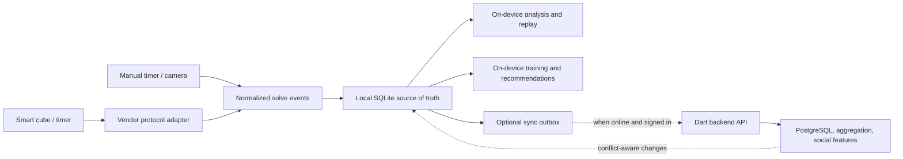

# Crubik Product Vision

**Status:** Draft for product and architecture alignment  
**Date:** 2026-07-16
**Product:** Crubik — an offline-first companion for smart Rubik's cubes and twisty-puzzle training

## Executive summary

Crubik is a fast, cross-platform companion for people who practice speedcubing with a Bluetooth smart cube, a Bluetooth timer, or an ordinary cube. Its defining promise is simple:

> A cuber can connect, scramble, solve, review, and train without an account or an internet connection. Going online adds synchronization, aggregation, sharing, and competition; it does not unlock the basic value of the product.

The product should combine the immediacy of a physical timer, the move-level insight of a smart-cube analyzer, and the structure of a personal coach. It should work across cube vendors and give the user ownership of their history. This creates a credible alternative to a vendor-specific application such as GAN CubeStation and a differentiated alternative to browser-first tools such as Cubeast.

Crubik should not try to win by copying every competitor screen. It should win through four durable advantages:

1. **Local-first reliability:** the complete practice loop works with no network and no mandatory sign-in.
2. **Open hardware support:** one consistent experience across multiple smart-cube and timer vendors.
3. **Actionable coaching:** replay and statistics lead directly into focused exercises, algorithm practice, and measurable improvement.
4. **Data ownership:** local history, transparent calculations, and portable import/export are first-class product capabilities.

The client should be built in Dart and Flutter for Android, iOS, macOS, Windows, and Linux. The web can provide shared replays and lightweight access, but should not define the Bluetooth architecture because browser Bluetooth support is uneven. An optional Dart backend can provide account sync, aggregate analytics, friend challenges, leaderboards, and content updates.

## Product vision

### Vision statement

Crubik makes every cube turn useful. It gives cubers a dependable practice environment anywhere, explains what happened in each solve, and turns that evidence into the next best thing to train—without locking the user to a cube brand, platform, account, or cloud service.

### Product category

Crubik is a **personal speedcubing workspace**, not only a timer and not only a smart-cube viewer. It connects five activities that are often fragmented:

- capturing solves;
- understanding solves;
- learning and editing algorithms;
- planning and measuring training;
- optionally competing and sharing with other cubers.

### Target users

- **Primary:** beginner-to-advanced 3×3 speedcubers who own a Bluetooth cube and want faster feedback than video review or manual notes.
- **Secondary:** cubers using regular cubes and external timers who want one durable statistics and training system.
- **Coaches and clubs:** people who review solves, prepare exercises, or run local and remote challenges.
- **Enthusiasts:** users interested in alternate methods, non-3×3 puzzles, Fewest Moves, blindfolded solving, visualizations, and playful cube experiences.

### Core user jobs

When practicing, users should be able to say:

- “Let me start solving now; do not make me wait for a login, loading screen, or pairing flow.”
- “Record the solve accurately even if my internet is unavailable.”
- “Show where I lost time and let me replay the exact moves.”
- “Recognize the algorithms I used and help me execute or choose them better.”
- “Give me a focused exercise based on evidence, not a generic tutorial.”
- “Keep all of my history together when I change cube brand or device.”
- “Let me compete with friends when I want to, without making social features a prerequisite for solo practice.”

## Why Crubik is needed

### Problems to solve

#### 1. Practice is too easy to interrupt

A practice tool loses value when it introduces a slow launch, compulsory authentication, repeated pairing, or a network dependency between the user and the timer. Smart-cube practice should feel like picking up the cube: launch, reconnect, and solve.

#### 2. Hardware ecosystems fragment the user's history

Cube vendors use different Bluetooth protocols and data formats. A user who changes from GAN to MoYu, GoCube, Giiker, or another vendor should not have to change their training workflow or abandon previous statistics.

#### 3. Statistics often describe performance without improving it

A chart can show a slow solve but may not explain why it was slow or what to practice next. Crubik should connect phase timing, pauses, turns per second, move count, rotations, regrips, and detected algorithms to a concrete replay and a repeatable training task.

#### 4. Cloud-first data creates avoidable fragility

The cube, phone, and user are physically together. Capturing moves, calculating solve metrics, rendering charts, recognizing known algorithms, and running training exercises do not inherently require a server. Requiring one introduces latency, outages, privacy concerns, and the risk that a discontinued service makes the product unusable.

#### 5. Cubers lack a neutral, portable record

Solve history should remain useful across devices and services. Users need export, import, documented metric definitions, and control over cloud upload. The local database is the source of truth for individual practice; the server is a synchronized extension of it.

#### 6. Training, content, and competition are disconnected

Algorithm databases, timers, replay tools, training plans, and friend competitions often live in separate products. Crubik can make the solve itself the link: an observed weakness becomes an algorithm set, an exercise, a plan item, or a challenge.

### Competitive position

[Cubeast](https://www.cubeast.com/) already sets a strong baseline with broad Bluetooth-cube support, solve analysis, statistics, sharing, timers, and training content. GAN CubeStation has the advantage of being a first-party experience for GAN hardware. Crubik therefore needs more than surface-level feature parity.

Its position should be:

> **The fast, offline-first, vendor-neutral cubing coach with user-owned data.**

This is a product direction, not a claim that competitors fail at every item. Competitive comparisons should be tested against current releases before being used in public marketing.

## Product principles

1. **Offline is the default operating mode.** Features run locally unless there is a concrete reason they cannot.
2. **No account before value.** A new user can connect a cube or start a manual timer immediately. Authentication appears only when an online capability needs it.
3. **Local data is authoritative.** A server outage must not block, discard, or rewrite a local solve.
4. **Hardware differences stay behind adapters.** Product features consume a normalized move stream, not vendor-specific packets.
5. **Every insight should be explainable.** A recommendation links back to metrics, phases, moves, and comparison criteria the user can inspect.
6. **Fast for beginners, deep for experts.** Defaults should be approachable while advanced metrics and configuration remain available.
7. **Portability over lock-in.** Import/export and stable domain formats are product requirements, not maintenance utilities.
8. **Privacy and competition are opt-in.** Private practice remains private; public results require explicit user action and server-side integrity controls.

## Offline and online operating modes

The application is one product with two capability levels, not two separate applications.

| Capability | Offline/local mode | Optional online extension |
| --- | --- | --- |
| Start and profile | Immediate local profile; no login | Account linking and multi-device identity |
| Cube/timer connection | Discovery, pairing, auto-reconnect, battery and state | Protocol compatibility metadata and diagnostics upload with consent |
| Solve capture | Scramble, inspection, timer, move stream, penalties, sessions | Backup and cross-device synchronization |
| Replay and analysis | Phase detection, TPS, pauses, move count, algorithm matching, charts | Aggregate comparisons and compute-heavy experimental analysis |
| Training | Algorithm sets, drills, metronome, local plans and progress | Content refresh, SpeedCubeDB access, shared plans, richer recommendations |
| Regular cubes | Manual timer, Bluetooth timer, manual result entry; later on-device camera recognition | Optional content lookup and backup |
| Social | Local profiles and same-device/local-network activities where practical | Friend challenges, shared replays, leaderboards, anti-cheat validation |
| Data management | Full local history plus import/export | Encrypted backup and conflict-aware sync |
| Localization and accessibility | Bundled translations and settings | Translation/content updates |
| Widgets and visualizations | Cached local data and on-device rendering | Synced highlights or shared sessions |

The online state must be visible but unobtrusive. Pending uploads should use a durable outbox and retry automatically. Losing connectivity during a solve must have no effect on capture or analysis.

## Key product pillars and features

### 1. Frictionless solve capture

This is the foundation of the product and must be excellent before advanced coaching is added.

- **Quick start:** open directly into the last practice workspace. No network splash screen and no login gate.
- **Instant auto-connect:** remember approved devices, scan safely, reconnect, restore the last known cube state, and make connection quality visible without dominating the UI.
- **Multi-vendor support:** normalize device events into the same solve model and expose device-specific capabilities such as battery, gyroscope, historical moves, or timestamps through capability flags.
- **Configurable orientation:** support color scheme and physical orientation independently during scrambling, solving, replay, and visualization.
- **Multiple input methods:** smart cube, Bluetooth timer, keyboard/touch timer, manual entry, imported solve, and later camera-based state entry.
- **Capture resilience:** detect dropped or duplicated moves, compare calculated and reported cube state, recover after a short disconnect where the protocol permits, and let the user repair or invalidate a solve.

### 2. Solve intelligence

Crubik should preserve the raw evidence and derive metrics from it. This allows calculations to improve without losing historical fidelity.

- Fluid local charts for time, averages, consistency, move count, TPS, pauses, and phase splits.
- Solve replay with scrubbing, speed control, cube orientation, move timeline, and overlays for pauses, rotations, regrips, and detected algorithms.
- Initial method-aware analysis for CFOP, with an extensible phase model for Roux, ZZ, beginner methods, and user-defined phases.
- Algorithm matching that tolerates AUF, rotations, equivalent sequences, setup moves, cancellations, and partial matches.
- Separate recognition and execution measurements where the event stream supports a defensible distinction.
- Formula-level statistics: execution time, success rate, move efficiency, consistency, and change over time.
- Transparent metric definitions and the ability to recompute derived analysis after an engine update.

“Advanced statistics” should not become a wall of charts. The default review should answer three questions: **What happened? What mattered most? What should I train next?**

### 3. Deliberate training and coaching

- **Algorithm training mode:** dedicated sessions and statistics so drill results do not distort normal solve history.
- **SpeedCubeDB integration:** search and cache algorithm content, suggest algorithms that match an observed case, and deep-link to the source. Offline access should use only content the user has saved or that licensing/API terms permit bundling or caching.
- **Algorithm editor:** start from a known formula, edit turns, validate equivalence, preview the result, tag finger-trick notes, and save a personal variant without overwriting the source formula.
- **Look-ahead and metronome drills:** configurable pace, progressive difficulty, pause detection, and no-move-burst exercises.
- **Improvement recommendations:** rank a small number of evidence-backed opportunities such as reducing a recurring pause, learning a missing case, lowering rotations, or improving a phase transition.
- **Individual plan:** translate recommendations and user goals into short daily exercises, spaced repetition, streaks that do not punish healthy breaks, and periodic reassessment.

Recommendations should begin with deterministic, explainable rules. Machine-learning or aggregate-user comparisons can be added online later, but should never be required for useful coaching.

### 4. Social practice and competition

- Friend challenges with a shared scramble or scramble set, a time window, clear penalty rules, and asynchronous or live modes.
- Friend statistics and leaderboards scoped by event, time period, input type, cube, and verified/unverified result status.
- Shareable solve replays with privacy controls.
- Cooperative or head-to-head construction games on a shared large screen, supporting 1-on-1 and team formats.
- Achievements that reward meaningful practice milestones rather than only raw speed; optionally mirror eligible achievements to platform services such as iOS Game Center.

Online results must distinguish smart-cube-verified data, timer-only data, imported data, and manually entered data. Friendly leaderboards can remain permissive; competitive boards need server-issued scrambles, signed event submissions where possible, anomaly detection, and an appeal path.

### 5. Ownership, accessibility, and reach

- Import and export common timer/session formats plus a documented, lossless Crubik format containing raw events and derived metrics.
- Russian, English, and Simplified Chinese localization, with notation, number, time, and typography tested separately from translated strings.
- Accessible color schemes, color-blind-safe cube palettes, screen-reader labels, scalable text, keyboard navigation, reduced motion, and haptic/audio alternatives.
- Home-screen widgets that show recent progress, a next exercise, or an animated scramble/solve without exposing private data by default.
- Consistent mobile and desktop experiences with layouts adapted to the available space rather than stretched phone screens.

### 6. Expansion and delight

- Support for ordinary cubes through manual timing and Bluetooth timers, then on-device camera recognition.
- Additional WCA disciplines, including Fewest Moves and blindfolded practice, with discipline-specific data rather than forced reuse of a speedsolve model.
- Twisty-puzzle support based on a generic puzzle definition, notation, state, and scramble layer.
- Experimental cube-to-crab morphing as a brand/easter-egg visualization. It should remain isolated from the core renderer and never delay reliability or analysis work.

## Hardware and puzzle support strategy

### Definition of “supported”

A model should not be advertised as supported because it merely pairs. A certified smart cube must pass tests for:

- discovery, first pairing, remembered reconnect, and clean disconnect;
- initial state and solved-state handling;
- correct face/move mapping for every supported orientation;
- ordered moves and timestamps under fast turning;
- missed-packet detection and state resynchronization where available;
- battery reporting where the device provides it;
- behavior across supported operating systems and representative firmware versions.

Each adapter should publish capability flags, known firmware limitations, and a tested-device matrix. Protocol families should be implemented once, while certification remains model-and-firmware specific.

### Target smart-cube matrix

The following is the intended support roadmap, not a claim that the current starter application already supports these devices.

| Tier | Vendor/protocol family | Target models or families | Rationale |
| --- | --- | --- | --- |
| Launch/P0 | GAN legacy and Gen 2–4 protocols | GAN 356i family; GAN Mini ui FreePlay; GAN12 ui / ui FreePlay / ui Maglev; GAN356 i Carry, Carry S, i 3, and Carry 2; GAN14 ui FreePlay | Large installed base and multiple protocol generations; native access can also avoid some Web Bluetooth MAC-address friction. |
| Launch/P0 | MoYu AI and MoYu32 | MoYu AI 2023 plus packet-tested `WCU_MY32`; certify exact MoYu models and firmware individually | Major alternative vendor and important proof of vendor neutrality without treating packet coverage as hardware certification. |
| Expansion/P1 | Monster Go / GAN-compatible | Monster Go 3Ai and compatible `MG`/`AiCube` devices after hardware certification | Reuses GAN-family protocol work while reaching a lower-cost segment, without expanding the P0 certification promise beyond GAN and MoYu. |
| Expansion/P1 | GoCube family | GoCube and Rubik's Connected | Established non-GAN protocol family and beginner-friendly hardware. |
| Expansion/P1 | Giiker/Xiaomi family | Giiker Super Cube i3S and Xiaomi Mi Smart Magic Cube | Common legacy/entry devices; Cubio provides a Flutter reference for the Giiker i3S but is not a general protocol library. |
| Expansion/P2 | Additional current 3×3 BLE families | QiYi and other actively sold smart cubes after protocol, license, and device testing | Move toward broad market coverage without making unverified compatibility promises. |
| Ongoing | New revisions | New GAN, MoYu, QiYi, and other vendor releases | Adapter architecture, recorded packet fixtures, and a device lab should make additions incremental. |

P0 is intentionally limited to certified GAN and MoYu cubes. This is enough to validate the multi-vendor adapter architecture while containing hardware procurement, firmware coverage, BLE edge cases, and release testing. Protocol support for another family should not be pulled into P0 merely because parts of its implementation can be reused.

The named GAN compatibility examples are grounded in the protocol coverage documented by [gan-web-bluetooth](https://github.com/afedotov/gan-web-bluetooth); the broader Giiker/Xiaomi, GAN/Monster Go, GoCube/Rubik's Connected, and MoYu protocol families are also represented in open smart-cube implementations derived from csTimer. Every device still requires testing in Crubik before release.

### Timers and ordinary cubes

- Begin Bluetooth-timer support with the GAN Smart Timer, whose event protocol is publicly documented.
- Add other Bluetooth timers behind the same device-adapter boundary when protocols and test hardware are available.
- Support ordinary cubes from the first stable release through touch/keyboard/manual timing and session statistics.
- Add camera state recognition later using an on-device pipeline. Camera input should help initialize/repair state and enter scrambles; it should not be presented as move-level tracking unless accuracy supports that claim.

### Puzzle scope

The smart-cube MVP is **3×3×3**. The domain model should nevertheless avoid hard-coding 3×3 assumptions outside the 3×3 analysis module.

Planned regular-puzzle coverage should follow WCA events where practical: 2×2 through 7×7, 3×3 one-handed, blindfolded and Fewest Moves, Clock, Megaminx, Pyraminx, Skewb, and Square-1. Smart tracking for other puzzle types should be added only when suitable hardware and protocols exist. The current Rust project formerly called `twsearch`, now [Twizzle Pattern Searcher (`twips`)](https://github.com/cubing/twips), is a promising later-stage engine for multi-puzzle search and scrambles.

## Technical vision

### Client platforms

Use a single Flutter/Dart codebase for:

- Android and iOS as the primary Bluetooth and practice platforms;
- macOS, Windows, and Linux for desktop review, training, coaching, and compatible Bluetooth use;
- web for shared replays, public profiles, and limited practice where browser capabilities permit.

Flutter officially supports mobile, desktop, and web deployment, including native Windows, macOS, and Linux applications. Bluetooth support must still be validated per platform. TV experiences should initially target responsive desktop/web casting or supported Android large-screen devices; tvOS is not currently an official Flutter deployment target and should not be promised without a separate feasibility decision.

### Recommended architecture

- **UI:** Flutter with adaptive layouts, Material/Cupertino platform behavior where useful, localization from the start, and a feature-oriented presentation layer.
- **State management:** Riverpod or an equivalent testable unidirectional state layer. Choose one approach project-wide rather than mixing patterns by feature.
- **Domain core:** pure Dart packages for puzzle notation, cube state, move events, sessions, phase detection, metrics, training, and sync-neutral entities.
- **Bluetooth/device layer:** a federated Flutter plugin with a stable Dart interface and platform implementations using Kotlin, Swift, and native desktop APIs where general BLE packages are insufficient. Each vendor protocol is a separate adapter package.
- **Persistence:** SQLite through a maintained Dart abstraction such as Drift. Store immutable raw solve/move events plus versioned derived analysis, preferences, cached content, and a durable sync outbox.
- **Compute:** Dart isolates for solver/search work, analysis recomputation, imports, and chart aggregation so capture and animation remain responsive.
- **Rendering:** Flutter-native 2D/3D rendering for the cube and timeline where feasible. Avoid requiring Unity for the core experience; it increases binary, build, and platform complexity for a visualization that can be represented from the domain state.
- **Backend:** an optional Dart service, with Serverpod as a strong candidate because it provides type-safe Dart client/server models, PostgreSQL access, authentication, and real-time streams. Use PostgreSQL for accounts, synchronized entities, challenges, leaderboards, and aggregate analytics; object storage for replay exports or user media; and background jobs for aggregation.
- **Observability:** local structured logs and opt-in diagnostics. Never upload raw solve history or device identifiers without clear consent.

### Data model and synchronization

The durable core should include `UserProfile`, `Device`, `Puzzle`, `Session`, `Scramble`, `Solve`, `MoveEvent`, `Penalty`, `Analysis`, `Algorithm`, `TrainingExercise`, `TrainingResult`, and `ChallengeResult`.

Important design rules:

- A `Solve` retains its raw event stream, input source, clock source, orientation, device/firmware metadata, and analysis-engine version.
- Derived metrics can be discarded and recomputed; raw events cannot.
- Local identifiers are generated before a network request.
- Sync is operation/outbox based, resumable, idempotent, and tolerant of long offline periods.
- Append-only records such as completed solves normally merge; mutable metadata uses explicit field/version conflict rules.
- Deletion uses tombstones long enough to propagate to other devices.
- Users can disable sync, unlink an account without losing local data, and delete server data independently.

### Cube, scramble, and solving libraries

Candidate libraries and reference implementations serve different purposes and must be evaluated independently for capability, maintenance, licensing, and platform fit.

| Option | Assessment for Crubik |
| --- | --- |
| [`tiagohm/cuber`](https://github.com/tiagohm/cuber) | Best fit for an initial pure-Dart 3×3 state model and two-phase solver. Place it behind a Crubik interface and benchmark startup, memory, solve latency, correctness, and maintenance before adopting it as the only engine. |
| [`thewca/tnoodle-lib`](https://github.com/thewca/tnoodle-lib) | Authoritative behavioral reference for WCA scramble generation. Its algorithms and edge-case behavior should be analyzed when defining the Dart engine, but a direct Java-to-Dart port would remain subject to GPL-3.0 obligations. Only the current WCA scramble program has official status; a compatible Crubik implementation would still be for training and unofficial events unless separately approved by the WCA. |
| [`cubing/cubing.js`](https://github.com/cubing/cubing.js) | Mainstream reference for puzzle notation, random-state scrambles, puzzle definitions, search, and visualization. Its `cubing/scramble` API covers all official WCA events and is a strong semantic and test reference for a Dart implementation. Avoid embedding a JavaScript runtime in the native core; analyze and port the required concepts or algorithms under a reviewed license strategy. The package is dual-licensed MPL-2.0 or GPL-3.0-or-later. |
| [`cubing/twips`](https://github.com/cubing/twips) | Rust-based multi-puzzle search and scramble engine intended to replace TNoodle. A promising future FFI component for broad puzzle support; isolate it behind an engine boundary and review its MPL/GPL licensing. The link in the source survey redirects from the former `twsearch` name. |
| [`BranislavMateas/cubio`](https://github.com/BranislavMateas/cubio) | A Flutter/Unity sample application specifically for the Giiker Super Cube i3S, not a general Dart cube library. Useful as implementation research, but not the basis of multi-vendor architecture. |
| `unixpickle/cube` | The survey labels it Dart, but the maintained project is a Go 3×3 solver (`gocube`). Do not select it as a Dart dependency. |
| [`cs0x7f/min2phase`](https://github.com/cs0x7f/min2phase) | Strong Java two-phase 3×3 reference. Use for algorithm validation or test vectors unless a measured need justifies a platform bridge. |
| `cubing/mark2` and other old projects | Do not use as core dependencies without a specific capability, license review, and maintenance assessment. |

### Dart port strategy for scramble infrastructure

Crubik should treat TNoodle and cubing.js as upstream reference implementations and deliberately build the required native Dart capability. This is more sustainable than depending on a Java or JavaScript runtime in every Flutter target and more credible than inventing scramble behavior without comparison to the mainstream cubing ecosystem.

The goal is not a line-for-line port of both repositories. Start with an architecture and provenance review, then port or independently implement the smallest coherent layers needed by the roadmap:

1. **Notation and algorithm model:** WCA notation, parsing, normalization, inversion, grouping, commutators/conjugates where needed, and stable serialization.
2. **Puzzle state and transformations:** a generic transformation model, with an optimized 3×3 representation for solve capture and analysis.
3. **Randomness contract:** an injectable cryptographically secure random source for production and a deterministic seeded source for tests. Avoid modulo bias and record enough provenance to diagnose generated scrambles without making future results predictable.
4. **3×3 random-state scrambles:** the first production target, generated fully offline and validated against applicable WCA constraints and mainstream reference behavior.
5. **Additional WCA events:** add event-specific random-state or random-move generators in roadmap order rather than porting every puzzle before it is exposed in the product.
6. **Search and solving:** port only the search primitives required for scrambling, state repair, algorithm validation, or supported training features. Keep high-cost multi-puzzle search replaceable by a later Rust FFI engine.

Each implementation unit needs an explicit provenance record:

- **Derivative port:** copied or translated structure/code retains the applicable upstream copyright and license obligations. cubing.js's MPL-2.0 option may be workable with file-level source obligations, while a TNoodle-derived port needs a GPL compatibility decision.
- **Specification/behavior implementation:** implement from WCA rules, documented formats, published algorithms, and black-box reference results without copying source structure. Record the design sources and have the boundary reviewed before calling it clean-room work.
- **Upstream collaboration:** where practical, ask maintainers whether a reusable core, generated test corpus, or Dart port can be contributed or licensed in a way that benefits both ecosystems.

Licensing must be decided before porting begins, not after code has been translated. If Crubik's distribution model is incompatible with a direct TNoodle derivative, use TNoodle as a conformance oracle and implement the required behavior from specifications and independently derived algorithms. This document is an engineering recommendation, not a legal conclusion.

The Dart package should expose Crubik-owned interfaces for puzzle state, notation, scramble generation, solving, and algorithm matching. A scramble result should include the event, algorithm, resulting state or state digest, generator/version, and policy metadata. This preserves reproducibility and allows the engine to evolve without making old solve records ambiguous.

Conformance should be broader than comparing a few scramble strings:

- property-test notation parsing, inversion, transformations, reachability, and state validity;
- run deterministic vectors through Dart and upstream engines where their random source can be controlled;
- otherwise compare resulting states, length/notation constraints, minimum-distance rules, prefixes/suffixes, and large-sample distribution properties rather than expecting identical random output;
- cross-check a generated scramble by applying it, solving the resulting state with an independent engine, and replaying the inverse transformation;
- maintain versioned golden vectors for every event and edge case, including Fewest Moves prefixes/suffixes and puzzle-specific notation;
- periodically rerun compatibility tests when TNoodle, cubing.js, WCA regulations, or supported event definitions change.

Recommended direction: analyze both mainstream repositories first, write an architecture/licensing decision record, then create a pure-Dart 3×3 notation/state/scramble package for the first offline release. Use cubing.js and TNoodle as independent conformance references, not runtime dependencies. Extend the Dart engine event by event, while retaining the option to use a Rust FFI engine for computationally expensive multi-puzzle search.

All third-party code and algorithm-data sources, including SpeedCubeDB, require a license and distribution review before code or content is bundled, cached, translated, or modified.

### Quality strategy

- Maintain captured BLE packet fixtures for each protocol, model, and firmware; replay them in deterministic tests without hardware.
- Add physical device tests for fast turns, sleep/wake, background/foreground, airplane mode, interrupted sync, and clock drift.
- Cross-check cube state and scramble/solution output against at least one independent engine using randomized sequences.
- Run the Dart scramble conformance suite against pinned TNoodle and cubing.js versions, and review differences before updating either reference version.
- Treat analysis formulas as versioned domain code with golden solves and expert-reviewed expected phases.
- Keep UI animation downstream from the recorded state so dropped frames cannot cause dropped moves.
- Test the complete critical path with network disabled and with an empty account state.

## Delivery strategy

### Phase 0 — trustworthy offline foundation

- Immediate launch into a local workspace with no mandatory account.
- 3×3 model, scramble, orientation, timer, session, penalties, and local database.
- Pure-Dart notation, state, and 3×3 scramble engine developed against TNoodle/cubing.js conformance fixtures.
- BLE adapter framework plus a small, explicitly certified set of GAN and MoYu cubes.
- Auto-reconnect, state validation, raw move capture, replay, and recovery UX.
- Core statistics and responsive charts computed locally.
- Lossless Crubik export early enough to protect test-user data.

Exit criterion: a user can install the app, enable airplane mode, connect a previously approved cube, complete a long session, review every solve, close/reopen the app, and lose no data.

### Phase 1 — useful personal coach

- Expand certification within the GAN and MoYu families, then add the first post-launch protocol families—prioritizing Monster Go/GAN-compatible, GoCube/Rubik's Connected, and Giiker/Xiaomi—and Bluetooth timer support.
- Configurable orientation throughout the workflow.
- Algorithm training sessions and formula-level statistics.
- SpeedCubeDB integration with permitted caching and source attribution.
- Import/export adapters for priority third-party formats.
- Initial evidence-based recommendations.

Exit criterion: Crubik can identify a meaningful weakness from local solve history and take the user directly into a drill whose progress is measured separately.

### Phase 2 — portable, social product

- Optional account, encrypted transport, backup, and conflict-aware multi-device sync.
- Friend challenges, shared replays, friend statistics, and scoped leaderboards.
- Advanced replay matching and algorithm editor.
- Regular-cube workflows, achievements, Russian/English/Chinese releases, and initial large-screen cooperative modes.

Exit criterion: users can move between devices without losing history and can complete a fair friend challenge while offline periods are handled gracefully.

### Phase 3 — adaptive and multi-puzzle expansion

- Individual training plans and richer improvement recommendations.
- Look-ahead and metronome programs.
- Camera state recognition performed on device where feasible.
- Additional WCA disciplines and generic twisty-puzzle engines.
- Widgets, experimental visualizations, and expanded large-screen games.

Exit criterion: expansion features reuse the same event, analysis, and sync foundations rather than introducing parallel data silos.

## Success measures

Targets should be refined after baseline testing, but the product should measure:

- median warm start to usable local timer under one second on supported mid-range phones;
- median reconnect to a remembered, awake cube under two seconds where the OS permits;
- zero lost solves in offline, crash-recovery, and interrupted-sync test suites;
- packet/move loss below a defined protocol-specific threshold during certified stress tests, with detectable recovery when any loss occurs;
- percentage of sessions completed without sign-in or network-related interruption;
- analysis completion latency and chart frame performance on supported devices;
- import/export round-trip fidelity;
- sync convergence and duplicate rate after long offline periods;
- percentage of recommendations that users open, complete, and repeat;
- retention and measurable improvement within chosen training goals, without optimizing for unhealthy streak behavior;
- device coverage by active users, based only on opt-in anonymous diagnostics or support reports.

## Risks and mitigations

| Risk | Product impact | Mitigation |
| --- | --- | --- |
| Proprietary or changing BLE protocols | Devices break after firmware or hardware changes | Adapter isolation, hardware lab, packet fixtures, capability negotiation, firmware matrix, fast compatibility releases |
| Platform BLE differences | “Cross-platform” behavior is inconsistent | Native federated plugin, platform certification, explicit support matrix, desktop/web fallbacks |
| Incorrect phase or algorithm analysis | Coaching loses credibility | Raw-event retention, versioned analysis, golden solves, method profiles, explainable results, user correction |
| Clock drift and missing timestamps | Misleading execution metrics | Preserve cube and host clocks, calibrate/fit timestamps per protocol, expose confidence and data quality |
| Offline/online conflicts | Duplicated or missing history | Idempotent outbox, immutable solve events, stable IDs, tested merge rules, user-visible sync health |
| Social cheating | Leaderboards lose value | Input-source labels, server-issued scrambles, verification tiers, anomaly detection, separate casual/verified boards |
| Scope expansion | Reliability is delayed by novelty features | Gate phases with exit criteria; keep P3 experiments outside the core capture path |
| Third-party licensing/API changes | Features become legally or operationally unsafe | Dependency/source inventory, legal review, adapters, cached-content policy, replaceable engines |
| Sensitive behavioral data | Users lose trust | Local by default, data minimization, explicit sharing, export/delete controls, encrypted transport and storage |

## Non-goals for the first release

- Replacing official WCA competition systems or claiming that Crubik-generated scrambles are official competition scrambles.
- Supporting every smart cube before a reliable adapter and certification process exists.
- Requiring AI, cloud compute, or aggregate user data to produce basic solve feedback.
- Building a general social network before solo practice is dependable.
- Shipping all WCA puzzles, blindfold workflows, camera recognition, or TV games in the 3×3 smart-cube MVP.
- Using a heavy game engine solely to animate the standard cube.

## Feature proposal assessment

This table is the authoritative prioritized feature inventory for the product.

| Proposed feature | Priority | Primary mode | Recommendation |
| --- | --- | --- | --- |
| Offline Mode | P0 | Offline | Make it a system constraint and acceptance-test suite, not a settings toggle. |
| Instant auto connect to smart cube | P0 | Offline | Remember consented devices, reconnect in the background allowed by the OS, and show recoverable state. |
| Multiple cube vendors support | P0 | Offline | Build normalized events and separate protocol adapters; publish a certified model/firmware matrix. |
| Quick start | P0 | Offline | Open the last local workspace immediately; defer sync, content refresh, and authentication. |
| Advanced statistics and fluid charts | P0 | Offline | Compute locally from raw events, prioritize actionable summaries, and virtualize/cache expensive views. |
| SpeedCubeDB integration with auto-algorithm suggestion | P1 | Hybrid | Query online; allow permitted saved content and matching offline; retain attribution and personal variants. |
| Customizable cube orientation | P1 | Offline | Apply one orientation model consistently to scramble, capture, analysis, replay, and rendering. |
| Algorithm training mode | P1 | Offline | Separate drill sessions/metrics from solves while allowing progress comparison and plan links. |
| Bluetooth timer support | P1 | Offline | Begin with a documented/tested protocol such as GAN Smart Timer; preserve timer and host timestamps. |
| Import/export third-party statistics | P1 | Offline | Define a lossless canonical format first, then documented adapters with previews and round-trip tests. |
| Online friend challenge | P2 | Online | Use shared/server-issued scrambles, asynchronous first, verification tiers, and clear penalty rules. |
| Leaderboard and friend statistics | P2 | Online | Scope by event, period, input source, and verification; do not mix incomparable data silently. |
| Advanced algorithm matching in replay mode | P2 | Offline | Support AUF, rotations, setup moves, cancellations, equivalence, partial matches, and confidence. |
| Time statistics over formula execution | P2 | Offline | Track recognition/execution when defensible; compare consistency and trend, not only best time. |
| Editor of cube construction algorithm from SpeedCubeDB formulas | P2 | Hybrid | Fork source formulas into attributed personal variants; validate notation and equivalence locally. |
| Support regular cubes | P2 | Offline | Start with touch/keyboard/manual and Bluetooth timers; add camera-assisted state entry later. |
| Cooperative cube construction on one TV app | P2 | Hybrid | Prototype after responsive large-screen foundations; support local/shared-screen play before complex networking. |
| Achievements with iOS integration | P2 | Hybrid | Keep a local achievement ledger; optionally mirror eligible awards to Game Center after account consent. |
| Russian, English, and Chinese localizations | P2 | Offline | Establish localization architecture in Phase 0; ship languages as translations and content coverage mature. |
| Individual training plan | P3 | Offline first | Generate explainable local plans; use optional sync/content/aggregate comparisons online. |
| Recommendations to improve the current solving algorithm | P3 | Offline first | Start with deterministic rules linked to replay evidence; introduce online models only after validation. |
| Look-ahead and metronome trainings | P3 | Offline | Build focused drills using local move/pause detection and configurable progression. |
| Twisty puzzles support | P3 | Offline | Generalize definitions and notation early, but ship 3×3 first; add WCA puzzle engines incrementally. |
| Home-screen cube widget | P3 | Offline | Use cached data/animation and privacy-safe defaults; keep platform-specific widget code outside core UI. |
| Fewest Moves and blindfolded solving | P3 | Offline | Create discipline-specific workflows and metrics instead of forcing them into standard speedsolve analysis. |
| Cube state recognition from camera | P3 | Offline | Prefer on-device inference; use it first for state initialization/repair and manual-cube entry. |
| Cube-to-crab morphing visualization | P3 | Offline | Treat as optional brand delight/easter egg in an isolated renderer after core quality goals are met. |

## Decisions still required

1. Which exact cube models and firmware versions are available for the launch hardware lab?
2. Which solving methods and phase definitions are required at launch beyond CFOP?
3. What are SpeedCubeDB's API, attribution, caching, modification, and offline-distribution terms?
4. Will the Dart scramble engine be an MPL-compatible cubing.js derivative, a GPL-compatible TNoodle derivative, an independently implemented compatibility layer, or a combination with clearly separated provenance?
5. Which third-party import formats have the largest user demand and stable specifications?
6. Should the first backend be self-hosted Serverpod, a managed deployment, or deferred until the offline product reaches its exit criterion?
7. Which social results qualify as verified, and what level of anti-cheat is appropriate for a training app?
8. Which large-screen targets are commercially important enough to justify native platform work?
9. What privacy, retention, and child-safety requirements apply to accounts, friend features, and public profiles in launch regions?

## Source material and references

- [Flutter supported deployment platforms](https://docs.flutter.dev/reference/supported-platforms)
- [Flutter desktop support](https://docs.flutter.dev/platform-integration/desktop)
- [Flutter plugin and platform-channel guidance](https://docs.flutter.dev/packages-and-plugins/developing-packages)
- [Serverpod documentation](https://docs.serverpod.dev/next)
- [Cubeast feature overview](https://www.cubeast.com/)
- [GAN cube/timer open protocol implementation](https://github.com/afedotov/gan-web-bluetooth)
- [Cuber pure-Dart 3×3 solver](https://github.com/tiagohm/cuber)
- [TNoodle official WCA scramble-program core](https://github.com/thewca/tnoodle-lib)
- [cubing.js](https://github.com/cubing/cubing.js)
- [cubing.js scramble documentation](https://js.cubing.net/cubing/scramble/)
- [Twizzle Pattern Searcher (`twips`)](https://github.com/cubing/twips)
- [Cubio Giiker/Flutter reference application](https://github.com/BranislavMateas/cubio)
