# Crubik Product Vision

**Status:** Active MVP baseline and product direction
**Last updated:** 2026-07-23
**Product:** Crubik — an offline-first companion for Bluetooth smart Rubik's
cubes

## Mission

Crubik makes smart-cube practice feel as immediate and dependable as picking up
a physical timer:

> A cuber can connect, scramble, solve, review, and retain a practice session
> without an account or an internet connection.

The product combines a local timer, a live cube model, smart-cube move capture,
and durable solve history in one vendor-neutral workspace. The user owns the
local record; hardware and platform differences remain behind adapters.

This document defines the current product boundary and the constraints that
future work must preserve. It intentionally avoids maintaining a speculative
feature inventory. A capability outside the current baseline enters scope only
through an approved issue or architecture decision.

## Current MVP baseline

The `codex-mvp` branch implements the following 3×3 practice loop:

- immediate local startup with no login, account, backend, or network gate;
- a hardware-free demo/manual workflow and a Bluetooth smart-cube workflow;
- locally generated 20-move practice scrambles;
- inspection, touch and spacebar timing, move capture, and automatic completion
  when a connected cube reports a solved state;
- a Flutter-native interactive 3D cube visualization;
- responsive, intentionally distinct mobile and desktop layouts;
- local solve history, best time, session mean, average of five, deletion, and
  versioned JSON export;
- SQLite persistence on native platforms and IndexedDB-backed Drift persistence
  on web;
- remembered-device startup scanning and automatic reconnect when the operating
  system has already granted Bluetooth access;
- normalized smart-cube state, move, battery, and connection events;
- packet-tested support for the approved GAN and MoYu protocol families.

The following boundaries remain explicit:

- the generator produces a **practice scramble**, not a WCA random-state
  scramble;
- current JSON export contains solve summaries and timing/input metadata, not a
  lossless raw move-event stream;
- protocol implementations are packet-tested until exact models, firmware,
  platforms, state mapping, fast turns, recovery, and reconnect behavior are
  verified with physical hardware;
- there is no account, backend, cloud synchronization, social layer, or
  mandatory telemetry;
- GoCube support is a separate follow-up tracked by
  [issue #42](https://github.com/Hyponauts/Crubik/issues/42) and is not part of
  P0.

## Product principles

1. **Offline is the default.** The complete capture, timer, visualization,
   statistics, history, and export flow works locally.
2. **No account before value.** Authentication or connectivity must never gate
   a local practice session.
3. **Local data is authoritative.** Network loss or a future server outage must
   not block, discard, or rewrite a solve.
4. **Hardware differences stay behind adapters.** Product features consume
   normalized events rather than vendor packets.
5. **Protocol support is not certification.** Compatibility claims are limited
   to physically tested model, firmware, platform, and behavior combinations.
6. **Evidence is preserved.** Raw inputs must not be silently replaced by
   derived metrics as persistence evolves.
7. **Data remains portable.** The versioned Crubik format evolves compatibly and
   retains enough provenance to interpret old records.
8. **Privacy is the default.** Diagnostics are local and redacted unless the
   user explicitly chooses to share them.
9. **The MVP remains focused.** Later-tier integrations must not displace P0
   reliability, certification, or offline data integrity.

## User experience contract

### Quick start

The app renders the local practice workspace without waiting for network,
authentication, history loading, or Bluetooth reconnect. History initialization
and remembered-device discovery run asynchronously after the UI is created.

### Practice inputs

- Demo/manual mode is always available without Bluetooth hardware.
- A new demo scramble initializes the rendered cube to the scrambled state.
- When a physical cube is connected, its authoritative state drives the live
  visualization; generating a scramble must not overwrite that state.
- A solve can finish from locally applied moves or a solved state packet, and
  the recorded input source must preserve that distinction.

### Connection behavior

- Manual discovery shows identified cubes before unrelated BLE devices.
- Supported devices select a protocol adapter automatically.
- A successfully connected device is remembered locally.
- On the next native-app launch, Crubik scans for that exact device and connects
  without presenting another permission request when access already exists.
- Search, connection, success, failure, battery, and recovery states remain
  visible and actionable.
- The demo/manual route remains available when Bluetooth is unavailable,
  permission is missing, or a cube cannot connect.

### Local persistence

- Solve writes are serialized in completion order.
- Solves completed or deleted while history is loading are merged correctly.
- Pending writes are flushed before the owned database closes.
- Web persistence uses the version-matched Drift worker and SQLite Wasm
  artifacts committed to the repository.

## Hardware support

### P0 protocol scope

P0 is intentionally limited to GAN and MoYu. Adding another vendor requires a
separate issue, protocol and license review, deterministic packet fixtures, and
physical-device validation.

| Vendor/family | Implemented protocol coverage | Current evidence |
| --- | --- | --- |
| GAN Gen2 | GAN Mini ui FreePlay, GAN12 ui/ui FreePlay, GAN356 i Carry/Carry S/i 3, and compatible verified services | Packet fixtures for state, moves, serial recovery, malformed input, and encryption |
| GAN Gen3 | GAN356 i Carry 2 protocol | Packet decoding and adapter tests |
| GAN Gen4 | GAN12 ui Maglev and GAN14 ui FreePlay protocol | Packet decoding and adapter tests |
| MoYu AI 2023 | GAN Gen2-compatible packet format with MoYu key material | Encryption and adapter fixtures |
| MoYu32 | `WCU_MY32` service, including initial state, five-move recovery, cube timestamps, and battery | Packet and adapter fixtures; exact marketed models remain to be certified |

### Certification gate

A cube is not advertised as certified merely because it is discovered, pairs,
or passes packet fixtures. Certification requires evidence for:

- discovery, first connection, remembered reconnect, link loss, and clean
  disconnect;
- initial and solved-state handling;
- every supported face and direction;
- ordering, serial wraparound, timestamps, and fast turns;
- missed-move recovery and state resynchronization;
- sleep/wake and background/foreground behavior;
- battery reporting where available;
- each supported operating system and representative firmware version.

Supported-device documentation must distinguish packet-tested protocol coverage
from physically certified hardware.

### Expansion boundary

GoCube is the only currently named post-P0 vendor follow-up and is tracked by
issue #42. Monster Go, GoCube-compatible revisions, Giiker, Xiaomi, QiYi, and
other vendors are not implicitly scheduled by appearing in research or protocol
references. Each requires explicit prioritization.

## Puzzle and scramble scope

The MVP supports the 3×3×3 practice workflow. The pure-Dart cube model uses a
54-sticker representation, URFDLB notation, transformations, and Kociemba
facelet interchange.

The current generator creates a 20-move practice scramble while avoiding
immediate repeated faces and three consecutive moves on the same axis. It must
not be described as competition-grade. A future random-state generator requires
an explicit implementation and licensing decision plus conformance testing
against mainstream references such as TNoodle and cubing.js.

Other puzzles, WCA disciplines, Bluetooth timers, camera recognition, and
competition workflows are outside the current MVP unless separately approved.

## Current architecture direction

Crubik uses one Flutter/Dart codebase with feature-oriented boundaries:

- **Composition:** `CrubikApp` owns the production database, practice
  controller, connection controller, and input coordinator.
- **Presentation:** responsive widgets observe controllers and render
  interaction state; widgets do not decode packets or own solve rules.
- **Practice application:** `PracticeController` owns the practice state
  machine and timer; `SolveHistory` owns statistics and ordered persistence.
- **Cube application:** `CubeConnectionController` owns discovery, connection
  lifecycle, remembered reconnect, diagnostics, and normalized event delivery.
- **Transport boundary:** `CubeConnectionGateway` and `BleCentral` isolate the
  application from the BLE plugin.
- **Protocol adapters:** `CubeAdapterRegistry` identifies advertisements and
  selects GAN or MoYu sessions; each adapter owns its protocol handshake and
  packet translation.
- **Domain:** cube state, scramble, device, capability, and smart-cube event
  models are pure Dart and independent of widgets and BLE.
- **Persistence:** Drift repositories implement solve history and remembered
  device settings with local SQLite-compatible storage.

```mermaid
flowchart LR
    BLE["Bluetooth cube"] --> Central["BleCentral"]
    Central --> Gateway["CubeConnectionGateway"]
    Gateway --> Registry["CubeAdapterRegistry"]
    Registry --> Adapter["GAN / MoYu adapter"]
    Adapter --> Events["Normalized SmartCubeEvent"]
    Events --> Connection["CubeConnectionController"]
    Connection --> Input["PracticeInputController"]
    Demo["Demo/manual input"] --> Input
    Input --> Practice["PracticeController"]
    Practice --> UI["Responsive practice UI"]
    Practice --> History["SolveHistory"]
    History --> Drift["Drift repositories"]
    Drift --> Local["SQLite / IndexedDB"]
```

Future integrations must extend these boundaries rather than introduce
vendor-specific logic in widgets, unordered persistence, or a network dependency
inside the solve path.

## Data and portability

The current durable solve record contains:

- a stable local identifier;
- scramble text;
- elapsed time and move count;
- UTC creation time;
- input source;
- inspection duration;
- solve-start trigger.

The JSON format is versioned and forwards unknown input-source values without
silently collapsing them. Persistence migrations retain older solve records
without inventing unavailable metadata.

Raw move-event persistence, device/firmware provenance, penalties, replay data,
and analysis-engine versions require a compatible schema extension before they
can be promised as lossless export.

If optional synchronization is approved later, it must use a durable,
idempotent outbox over the local source of truth. Connectivity loss must remain
irrelevant to capture and local review.

## Priority policy

Priorities are ordered P0 through P3:

- **P0 — trustworthy offline foundation:** the current 3×3 practice loop,
  startup reconnect, GAN/MoYu adapter boundary, local history, portability,
  accessibility, and release-quality certification.
- **P1 — adjacent approved extensions:** capabilities close to the practice
  loop that receive explicit issues after P0 reliability is protected.
- **P2 — optional connected product:** account, synchronization, sharing, or
  social capabilities that remain additive to local practice.
- **P3 — experimental expansion:** additional puzzles, advanced coaching,
  camera-assisted input, and novelty experiences isolated from the core path.

Mentioning an idea, library, vendor, or protocol does not assign it to a tier.
Only an approved issue or product decision changes scope.

## Quality and release gates

Automated verification must cover:

- cube transformations and notation round trips;
- timer and practice-phase transitions;
- solve-history initialization, ordered writes, deletion, and migrations;
- responsive compact-phone and wide-desktop layouts;
- adapter recognition and initial-state handshake;
- fixed cipher vectors and encryption round trips;
- live moves, serial wraparound, missed-move recovery, malformed packets, and
  state resynchronization;
- connection cancellation, permission failure, diagnostics redaction, and
  remembered reconnect.

Physical release validation must cover airplane mode, long sessions, fast turns,
sleep/wake, background/foreground, disconnect/reconnect, and database
close/reopen behavior on supported hardware.

The offline release gate is:

> A user can install Crubik, enable airplane mode, reconnect a previously
> approved cube, complete a long practice session, review every recorded solve,
> close and reopen the app, and lose no data.

## First-release non-goals

- mandatory accounts, analytics, telemetry, or cloud services;
- a general social network, friend challenges, or leaderboards;
- compatibility claims for every smart cube;
- official WCA scramble or competition-system claims;
- lossless replay claims before raw move events are stored and exported;
- all WCA puzzles, blindfold workflows, camera recognition, or TV-specific
  games;
- a heavy game engine solely to animate the standard cube.

## Open decisions

1. Which exact GAN and MoYu model, firmware, and platform combinations will be
   physically certified for the first release?
2. What versioned schema will preserve raw move events, device provenance,
   penalties, and derived-analysis versions?
3. What implementation and licensing strategy will produce a validated
   random-state 3×3 scrambler?
4. Which native and desktop Bluetooth platforms meet the release-quality
   support bar?
5. Which explicitly approved capability should enter P1 after the offline
   release gate is met?

## Source material

- [Flutter supported deployment platforms](https://docs.flutter.dev/reference/supported-platforms)
- [Universal BLE](https://pub.dev/packages/universal_ble)
- [Drift](https://drift.simonbinder.eu/)
- [afedotov/gan-web-bluetooth](https://github.com/afedotov/gan-web-bluetooth)
- [TNoodle](https://github.com/thewca/tnoodle)
- [cubing.js](https://github.com/cubing/cubing.js)
- [WCA Regulations](https://www.worldcubeassociation.org/regulations/)

Protocol code adapted from third-party work retains its license and attribution
requirements in `THIRD_PARTY_NOTICES.md`.
